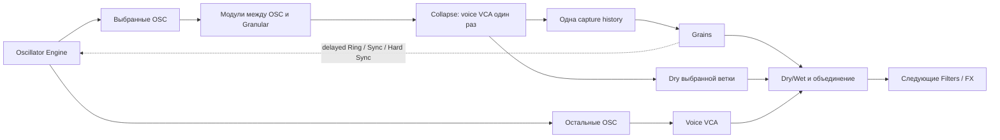

# Единый движок осцилляторов и связи с Granular

Создан: 1 ноября 2026. Обновлён: 2 ноября 2026 после реализации и нескольких проверок с Astra. Документ сохраняет архитектурный план; принятые при реализации решения и результаты проверок приведены в разделе 9.

## 1. Результат

Один Oscillator Engine управляет типами осцилляторов, голосами, связями и выходами. В одном банке можно смешивать RADIAS, Wavefolder, PCM и Wavetable. Осцилляторы Resynth и 303 используют ту же модель и runtime API с подходящим способом управления голосами.

Если Granular расположен после осцилляторов в звуковом маршруте, пользователь выбирает, какие OSC отправляются в его историю. Остальные продолжают звучать напрямую. Каждый OSC и каждая отдельная группа Granular A–D также являются узлами общей сети взаимодействий: OSC ↔ OSC, OSC ↔ группа и группа ↔ группа, в обоих направлениях, включая разные типы OSC.

Запрошенные режимы: **Sync, Hard Sync, Ring и Ring+Sync**. Ring и разновидность Sync хранятся независимо, поэтому доступен и Ring+Hard Sync. Общий wet-выход Granular остаётся дополнительным источником, но не заменяет отдельные группы.

Предлагаемые проектные решения:

| Вопрос | Решение для реализации |
| --- | --- |
| Размер нового обычного банка | До 8 смешанных OSC на ноту, без квот «4 Synth + 4 Wavetable». Это предлагаемый предел, а не требование из запроса; ресурсный бюджет проверяется отдельно. |
| Направления взаимодействий | Любой тип OSC ↔ любой другой тип OSC; OSC ↔ любая группа Granular; любая группа ↔ другая группа. Self/feedback связи тоже входят в граф. |
| Sync и Hard Sync | Новый Sync — плавное фазовое подтягивание; Hard Sync — мгновенный reset выбранной фазы. Старое поведение параметра с именем Sync сохраняется через compatibility mapping. |
| Фаза группы | Отдельные domains Playback / Clock / Both; default Playback. Группа не объявляется обычным периодическим осциллятором. |
| Источник событий | Natural cycle осциллятора, Group Clock, Grain Launch либо переходы звука через ноль; вид события явно сохранён в маршруте. |
| История | Одна stereo history суммы выбранных источников; выбор меняет будущую запись. |
| Старые инструменты | Сохраняют маршруты, параметры и звучание через совместимые представления единого движка. |

Требование «любой тип с любым» означает отсутствие запретов на пары типов. Где собственной управляемой фазы нет, её обеспечивает явно определённый transport adapter. Это не обещание физически изменить фазу входящего live audio. Существующие FM/PM/Cross сохраняются; свободный межтиповой FM/PM не нужен для выполнения запроса.

## 2. Исходное устройство проекта до реализации

| Участок | Текущее устройство | Следствие для плана |
| --- | --- | --- |
| [Synth settings](../rust/src/synth.rs), [DSP](../rust/src/dsp/synth.rs) | До 4 OSC, отдельные состояния каждой ноты; выходы для взаимодействий до Level/Pan; собственные правила задержки taps | Можно переиспользовать kernels и voice lifecycle, но нельзя просто расширить массив одним WT enum |
| [Wavetable settings](../rust/src/wavetable.rs), [interaction routing](../rust/src/dsp/wavetable/interaction/routing.rs) | 4 WT, собственные assets/unison/motion; FM/PM и Sync с oversampling, дробными событиями и коррекцией разрывов | Сохранить подготовку таблиц, качество и существующие interaction paths |
| [Resynth](../rust/src/resynth.rs), [DSP](../rust/src/dsp/resynth.rs) | 4 слоя × 16 спектральных полос; уже умеет Ring/Sync от Source/Grains/OSC, причём Grain Sync детектируется по полосам | Это особый voice domain; broadband Grain Sync не является заменой прежнего полосового режима |
| [Grain groups](../rust/src/grain_groups.rs), [group DSP](../rust/src/dsp/grain_groups.rs), `render_grains` в [engine DSP](../rust/src/dsp/mod.rs) | 4 группы; общий grain clock и weighted round-robin `deal`; отдельной group phase нет, а `group_sent` считается только при SEND | Нужны GroupClock, readhead anchors и demand-driven taps независимо от CHAIN/SEND; простой выбор группы в существующем selector задачу не решит |
| [Rack model](../rust/src/rack.rs), [render](../rust/src/dsp/rack.rs) | Synth и WT начинают разные цепочки с собственными FX и mixer strips; Granular записывает свёрнутый сигнал текущей цепочки | Автоматическое сведение старых банков в один source изменит звук |
| [Parameters](../rust/src/parameters.rs), [sequencer DSP](../rust/src/dsp/sequence.rs) | Разные адреса Synth/Resynth/WT/303; порядок выпущенных host parameters сохраняется | Нужен единый resolver с legacy aliases, а не переименование ID по номеру карточки |
| [Control](../rust/src/control.rs), [MIDI learn](../rust/web/midi.js) | Привязки к параметрам и элементам редактора, включая сохранённые selectors | Совместимость должна охватить и эти привязки |

## 3. Архитектура движка

### Единая модель, специализированные DSP

Ввести `OscillatorEngine` и одну модель `OscillatorSlot` со следующими частями:

- Стабильный `OscId`, тип, enabled, pitch/tune, Level/Pan и параметры соответствующего типа.
- `VoiceDomain`: обычные ноты, спектральные полосы Resynth, монофонический 303.
- Ссылки на подготовленные PCM/WT assets и общие ENV/LFO. DSP-состояния принадлежат конкретному голосу и его generation.
- Выход звука, tap для модуляции, события Sync и описание возможностей backend.
- Принадлежность выходной группе и отдельный порядок отображения.

Новый обычный банк содержит до 8 OSC любого из поддерживаемых note-типов. У Resynth остаются спектральные голоса, у 303 — монофонический VCO, slide/accent и его фильтр. Их специализированные owners обращаются к общему oscillator API. Лимит 8 не применяется к суммарному числу внутренних спектральных carriers и не обрезает старые патчи.

Общий движок должен владеть созданием, настройкой, рендером, taps и освобождением oscillator runtimes. Перенос только UI и таблицы параметров не завершает объединение. При этом фильтр 303, спектральный анализатор, drum machine, sampler и vocal не превращаются в обычные note-осцилляторы.

Обязательный охват backend/domain:

| Backend | Контекст управления |
| --- | --- |
| RADIAS, включая periodic/Formant/Noise | Poly note, spectral carriers Resynth, дополнительные mono layers 303 |
| Wavefolder и PCM | Poly note и spectral carriers Resynth |
| Wavetable | Poly note со всеми его собственными asset/motion controls |
| Audio In | Signal-only источник в поддерживающем его контексте Resynth, без управляемой фазы |
| 303 VCO | Mono303, с сохранением собственного pitch/slide/accent owner |

«Все осцилляторы» здесь охватывает owners Synth, Wavetable, Resynth и 303, включая Formant/Noise/Audio In. Voice domains определяют распределение голосов и состояний, а не запрет связать два разных типа: междоменные adapters описаны ниже. Перенос любого backend в любой voice domain не подразумевается. Внутренние генераторы drum machine в этот рефакторинг не входят.

Сохраняются типовые возможности: RADIAS Wave/Cross/Unison/VPM, Wavefolder shapes, PCM loop, WT Position/unison/Voice shift/Surf/Step и его библиотека/редактор. WT XY остаётся явно заданной группой до четырёх участников; его веса привязаны к OscId, а не к первым четырём карточкам смешанного банка.

Текущие WT runtime, interaction graph, команды редактора и telemetry содержат фиксированное A–D/4. Для нового банка их адресацию нужно обобщить на подготовленный список WT-slots среди восьми: разрешить и восемь WT, и перемежающиеся WT/RADIAS/PCM. Простого увеличения UI count недостаточно. Старый paired/четырёхоператорный путь сохраняется для legacy, а новые source selectors получают собственные адреса без расширения диапазонов выпущенной automation.

### Идентичность и параметры

Перестановка меняет `display_order`, но не OscId, automation address или связи. Удаление разрывает ссылки на удалённый OSC; соседний не занимает его идентичность. Повторное использование свободного места не восстанавливает старые связи. Undo восстанавливает объект и связи вместе.

Host automation адресует постоянный физический слот, например OSC 2; внутренние связи адресуют OscId. После удаления слот пуст и его automation не воздействует на соседей. Явное добавление нового OSC в этот же физический слот делает прежнюю automation этого слота применимой к новому содержимому, но не восстанавливает связи удалённого OscId. Номер физического слота сохраняется при перестановке карточек. Старые aliases закрепляются явно. Смена типа сохраняет идентичность, но несовместимый параметр не начинает управлять другим контролом.

Новая версионированная схема хранит слоты, группы, маршруты и compatibility mode. Render plan содержит только подготовленные численные адреса и ресурсы; поиск строковых ID, JSON и разрешение ссылок выполняются вне audio callback.

Общая сеть использует `NodeId = Osc(OscId) | GrainGroup(GroupId)` и отдельный `GrainWet` aggregate source. GroupId включает владельца Granular и постоянный group slot; подпись A–D и индекс массива не заменяют идентичность. Физические адреса групп остаются стабильны для host automation. Маршруты хранят source/target, taps, event kind, Ring depth, Sync mode/strength/reset phase, group scope, voice bridge и clock ratio.

### Audio и события

Разделить три контракта:

| Выход | Назначение |
| --- | --- |
| Modulation audio | Стадии Generation — после собственного Sync/DSP, до входящего Ring — и Output после Ring. OSC tap до пользовательских Level/Pan и voice VCA; group tap после per-grain обработки/окон/onset/pan и требуемого VCA, до group Level, CHAIN/SEND и общего Dry/Wet. Default — Generation; масштаб задаётся adapters без слежения за громкостью |
| Capture branch | Слышимый вклад выбранных OSC с их Level/Pan; voice VCA применяется при сворачивании ноты ровно один раз |
| Sync event | Вид события, timestamp с дробной позицией внутри sample и voice/domain identity; не просто `bool` уровня сигнала |

Нужные, но неслышимые модуляторы продолжают рендериться; group tap вычисляется по собственной demand mask даже при CHAIN=SEND=0. Group Level=0 не отключает её роль источника. Share=0 запрещает новые зерна, но не убивает уже звучащие хвосты. Power Off узла прекращает его audio/events и входящие воздействия с безопасным переходом и очисткой stale state. Банк не рендерит второй экземпляр OSC ради granular send, а группа не рендерит свои зерна повторно ради Ring.

Новые связи используют определённую временную шкалу, не зависящую от порядка карточек. Transport между разными kernels может работать в host sample time, но Ring/Sync/Hard Sync вычисляются с нужным oversampling, реконструкцией audio и коррекцией разрывов. Внутренние старые Synth/WT связи сохраняют прежние правила в compatibility mode.

## 4. Выбор входа Granular

Два режима входа:

- **Chain** — текущий вход целиком. Это default при миграции старых патчей.
- **OSC** — выбранные осцилляторы из реально предшествующего банка текущего звукового маршрута.

Доступность определяется графом цепочек, а не только расположением модуля выше на экране. Первый объём выбора — слоты одного предшествующего банка. Для произвольной суммы разных цепочек после Mixer сохраняется Chain; выбор вкладов после общей нелинейной обработки потребовал бы отдельного маршрутизатора.

В OSC-режиме разделение происходит на выходе банка, пока ноты ещё независимы:



Промежуточные Filters/FX обрабатывают выбранную ветку. Остальные OSC обходят эту часть маршрута и присоединяются после Granular. Процессоры ниже Granular слышат обе ветки. Этот bypass показывается линией в Rack. Не нужно дублировать нелинейные FX или пытаться вычитать из их общей суммы отдельный OSC.

Если выбранная ветка ещё per-note, её фильтры также остаются per-note; затем VCA применяется один раз перед capture. У обходящей ветки собственный однократный VCA. `selectedDry` в формуле ниже — уже обработанный сигнал перед Granular:

```text
output = unselectedDry + selectedDry × (1 − mix) + grainWet × mix
```

Таким образом, Wet=100% не глушит невыбранные OSC. Если не выбран ни один, новые внешние сигналы в историю не пишутся; весь банк идёт напрямую. Уже записанный материал, зерна и включённый grain feedback продолжают жить по текущим правилам.

Смена выбора плавно меняет вход будущей записи. Содержимое истории не пересобирается: прежние OSC слышны из неё до вытеснения. Freeze сохраняет записанный материал. При перемещении Granular перед банком выбор хранится, но становится неактивным; модуль использует доступный вход своей цепочки. Тип входа и неактивные связи видны в редакторе.

Используется одна история выбранной суммы. На 48 kHz 32 секунды stereo f32 занимают 12 288 000 байт (11,72 MiB) только под PCM; восемь таких историй — 93,75 MiB. Дополнительные mips, подготовка, переходы и WASM worker copies учитываются отдельно. Индивидуальная 32-секундная история каждого OSC здесь не нужна.

Группы читают эту же подготовленную историю или файл, но имеют свои зерна, clocks и readhead anchors. Связь A → B не копирует историю и не означает запись выхода A во вход B: это самостоятельное взаимодействие audio/phase поверх общего источника. Capture selection и InteractionGraph остаются разными настройками.

## 5. Общая сеть OSC ↔ OSC ↔ группы Granular

### Направления и режимы

Один `InteractionGraph` обслуживает все пары типов и все направления:

| Source → target | Примеры обязательного поведения |
| --- | --- |
| OSC → OSC | WT → RADIAS, PCM → WT, 303 → Wavefolder и обратные пары |
| OSC → группа | WT → группа A, Noise → группа C; Ring её звука либо Sync/Hard Sync её playback/clock |
| Группа → OSC | A → WT, C → 303, D → PCM; независимые masters для разных OSC |
| Группа → группа | A → B, B → A, C → D; взаимные и self-связи без зависимости от порядка A–D |
| GrainWet → узел | Суммарный звук зерен как дополнительный источник, не замена отдельным группам |

У target независимы Ring master и Sync master; ими могут быть разные узлы. Для первого выпуска предлагается один Ring master на audio target и один Sync master на фазовую область, с fan-out на любое число targets. У группы один audio Ring stage независимо от Playback/Clock scope. Это ограничение числа masters, а не разрешённых пар типов. Изменение master атомарно, с Undo. Панели OSC и групп редактируют одну модель маршрутов.

Scope Both занимает обе фазовые области группы; конфликтующий master Playback/Clock заменяется одной транзакцией, без скрытого одновременного исполнения двух masters одного состояния.

| Режим в UI | Параметры общего взаимодействия |
| --- | --- |
| Off | Ring=0, Sync=Off |
| Ring | Ring depth, Sync=Off |
| Sync | Ring=0, Sync=Soft |
| Hard Sync | Ring=0, Sync=Hard |
| Ring+Sync | Ring depth, Sync=Soft |
| Ring+Hard Sync | Ring depth, Sync=Hard |

Новый Sync означает ограниченное плавное подтягивание ошибки фазы к `reset_phase`, с strength/response и без мгновенного скачка. Hard Sync сразу переводит ту же фазу в reset phase с коррекцией разрыва. Nominal pitch/rate сохраняется; временная поправка Soft хранится отдельно. Это выбранная семантика новых режимов, её нужно закрепить DSP-тестами. Старый параметр с названием Sync, выполняющий hard reset, мигрирует в Hard/legacy mode и не меняет звук.

### Audio taps и Ring

Каждая группа публикует собственный сигнал после её grain DSP, amp/random gain, onset/pan и нужного voice weighting, до group Level, CHAIN/SEND и общего Dry/Wet. Не использовать gated `group_sent` как interaction source. Вычислять этот сигнал один раз по demand mask; одинаково подавать его в запрошенные interaction consumers и последующее суммирование.

У OSC и групп есть две стадии tap:

- **Generation**, default: после собственного Sync и генерации/DSP, до входящего Ring. Позволяет двум звучащим узлам рингить друг друга без нулевой блокировки из-за postRing taps.
- **Output**: после Ring для намеренных сетей с обработанной обратной связью.

Для общего моно-модулятора downmix задан как `(L + R) / 2`; это bipolar audio. Масштаб, DC handling и реконструкция закрепляются в adapter, без envelope follower или автоматической нормализации громкости.

```text
targetAudio = generationAudio × ((1 − ringDepth) + ringDepth × sourceAudio)
```

У OSC Ring стоит до Level/Pan, у группы — после формирования её сигнала до group Level/CHAIN/SEND. Оба канала target умножаются на один определённый modulation signal. При depth=0 путь нейтрален; при depth=1 тишина источника глушит target. Включение и depth сглаживаются. Новая раскладка group tap не переставляет умножения в legacy path.

В per-note маршруте промежуточные group contributions сохраняются по голосам до штатного collapse; общий Ring factor применяется к ним без преждевременного сведения. Aggregate tap для других узлов формируется с корректным voice weighting отдельно. Добавление interaction tap не превращает последующие per-note filters в общий stereo processor.

PostRing циклы могут затухнуть или остаться нулевыми; скрытого подмешивания dry/seed нет. Capture-feedback с пустой историей также не обещает самовозбуждения. В тестах отличать ожидаемое нулевое состояние от отсутствующего рендера источника.

### Источники событий

Вид source event задаётся отдельно от audio tap и сохраняется в патче:

| Вид | Семантика |
| --- | --- |
| Auto | Default нового маршрута: NaturalWrap для отдельного фазового голоса/полосы, GroupClockWrap для Generation группы, AudioZeroCross для Output, шумового или суммарного poly/spectral источника |
| NaturalWrap | Естественное пересечение цикла OSC; для poly → group/global нужно явно выбрать голос, чтобы не смешивать wraps разных нот |
| AudioZeroCross | Восходящие переходы выбранного Generation/Output audio через ноль, hysteresis и silence gate; default для звуковой синхронизации от группы |
| GroupClockWrap | Естественная граница отдельного clock группы, для ритмической синхронизации |
| GrainLaunch | Фактический запуск зерна; origin, group/voice identity и natural/forced являются частью события |

Групповая шумовая сумма не получает фиктивную общую периодическую фазу. Clock и waveform events остаются разными выборами. Clock ratio/reset phase входят в маршрут; деление/умножение clock не должно молча превращать нерегулярный аудиопоток в периодический. Существующий полосовой Grain Sync Resynth сохраняется как legacy source adapter.

### Sync и Hard Sync отдельных групп

Для target группы обязательны три scope; default — **Playback**, чтобы взаимодействие непосредственно меняло чтение её звука.

| Scope | Sync / Soft | Hard Sync |
| --- | --- | --- |
| Playback | Плавно подтягивает readheads уже активных зерен к их launch anchors с ограниченной поправкой фазы | Возвращает readheads уже активных зерен к их сохранённым launch anchors |
| Clock | Подтягивает фазу собственного group scheduler, сохраняя его темп между событиями | Reset clock и один grain birth на границе события, при разрешённом рождении зерен |
| Both | Оба воздействия на соответствующие фазовые состояния | Сначала reset snapshot активных зерен, затем один birth; новый grain повторно не сбрасывается |

Playback не меняет age, amp/filter envelopes, filter state, pitch/rate/direction и оставшееся время жизни. Не перезапускает MIDI note или всю группу. Reset phase=0 соответствует launch anchor; другая фаза отсчитывается по определённому при старте read span зерна. Soft корректирует позицию в той же системе координат, а не меняет clock под именем Playback.

Anchors хранят идентичность источника и логические координаты, учитывают reverse, границы выбранного региона и сдвиги rolling history. Если старый anchor вытеснен, reset ограничивается ближайшей доступной границей истории; исчезнувшая запись не восстанавливается. Freeze фиксирует историю. Смена sample/источника инвалидирует anchors вместе с соответствующими grains; правила проверяются на коротком buffer.

Для групп нужен новый scheduler mode с отдельными clocks. Его базовые частоты распределяют общую density пропорционально положительным Share; собственные clocks/ratio затем управляются маршрутами. Старый shared clock + `deal()` остаётся compatibility mode: включение новой модели не является побочным эффектом открытия пресета. Playback-only взаимодействия сами по себе не требуют менять старое расписание рождений.

Clock Hard создаёт один birth на boundary, иначе быстрый master постоянно обнулял бы медленный clock и останавливал зерна. Natural birth на той же границе дедуплицируется; forced birth имеет свой origin. При Share=0, Density=0 или выключенном engine новые births запрещены; активные хвосты обрабатываются по правилам Playback. Birth/event queues и общий grain pool ограничены заранее. При полном pool новый birth пропускается, существующие grains не уничтожаются произвольно; счётчик пропусков доступен в telemetry.

### «Любой тип с любым»: phase adapters и voice domains

Capabilities определяют способ исполнения, а не запрет на пару типов. Ring доступен любому audio node. Sync/Hard Sync используют native фазу либо явно подключённый phaseable transport:

| Target | Фазовая область для новых режимов |
| --- | --- |
| RADIAS periodic, Wavetable | Carrier phase; unison сохраняет согласованный spread; дробные события и антиалиасинг |
| Wavefolder | Фаза carrier без сброса smoothing/DC state |
| PCM | Фаза чтения loop/выбранного фрагмента |
| Formant | Native carrier phase при подтверждённой capability; остальное состояние сохраняется. Для неподдерживающего режима — segment transport |
| Noise | Воспроизводимый seeded segment с clock/readhead для новых phase modes; это не обещание периодического lock исходного случайного процесса |
| Audio In | Захваченное обновляемое audio window с собственным clock/readhead; Sync управляет воспроизведением окна, не фазой внешнего входа |
| 303 VCO | Native carrier phase без сброса slide/accent/ENV/ladder/pattern |
| Grain group | Playback / Clock / Both, как определено выше |

Noise/Audio In adapters входят в основной объём «любой с любым». Режим transport, размер/обновление окна и seed/rate видны в настройках и сохраняются. Они включаются при активном Sync для нуждающегося в окне target либо явно через Phase transport. Исходный live/noise режим сохраняется при выключенном Sync. Native targets сохранённых маршрутов, включая Off/disabled, заранее резервируют ограниченное окно вне callback: это позволяет DAW automation включить Sync или сменить waveform без выделения памяти. Общий бюджет окон — 64 MiB; превышение отклоняет подготовку, сохраняя текущий патч.

Между voice domains применяется сохраняемый bridge:

- Same-note: соответствие по voice identity/generation; self не означает соседний voice slot.
- Mono/global/group → poly: один source broadcast всем голосам выбранного target.
- Poly → global/group: определённый audio mix с voice weighting; для phase events — конкретная выбранная нота либо AudioZeroCross сведённого сигнала. Wraps всех нот не объединяются в неявный поток.
- Spectral ↔ note/group: выбранная полоса либо явный aggregate audio adapter; случайного соответствия по индексу массива нет.

Bridge учитывает уже применённые gains и добавляет voice VCA только при предусмотренном сведении необработанных per-voice contributions. Same-note/broadcast OSC modulation не получает дополнительный VCA; готовый group aggregate повторно не взвешивается. Смена voice generation, sample rate или удаление источника очищает его задержанные события. Выбор scope/event/voice сохраняется независимо от порядка карточек.

### Причинность, задержки и качество

Все **новые** рёбра, независимо от направления, читают один previous snapshot: при расчёте sample `n` доступны taps/events, опубликованные узлами в `n−1`. Логическая задержка каждого ребра — ровно один host sample; taps/events double-buffered, timestamps дробные. Начальные taps=0, events отсутствуют. Ни перестановка карточек, ни размер render block не меняют граф. Это правило общее для self, взаимных и длинных циклов.

Каждый kernel/bridge объявляет фактическую audio/event latency. Prepared render plan выравнивает необходимые dry/wet/interaction ветки на общей шкале; художественное время чтения из истории не компенсируется. Filter/resampling latency учитывается дополнительно, а компенсация не устраняет причинный sample ребра. Смена профиля требует подготовки и crossfade. Старые внутренние Synth/Resynth/WT paths сохраняют собственные правила и baseline audio.

Forced reset не становится NaturalWrap в новом графе. GroupClock reset и вынужденный birth не маскируются под natural clock wrap; GrainLaunch содержит origin. Использование forced launches как source возможно явно, но такие рёбра также задержаны и проходят bounded event policy. Никакого рекурсивного выполнения соседних узлов в том же sample.

Ring и hard jumps readheads требуют oversampling, реконструкции/ограничения полосы и коррекции разрывов. Новый смешанный банк использует постоянный профиль 8×, FIR из 641 коэффициента, дробные resets и BLEP/BLAMP; смена режима не переключает качество/задержку. Grain readheads и Ring обрабатываются при 4× с коррекцией разрывов и двухступенчатой фильтрацией. Старые WT FM 8× и legacy Hard Sync 32× сохраняются. Спектральный предел aliasing относительно независимого высокочастотного oracle — отдельная проверка качества; наличие oversampling само по себе не доказывает такой предел.

## 6. Совместимость и realtime

Старый пресет загружается в единый реестр, сохраняя группы выходов, исходный порядок модулей, filters/FX и mixer strips. Старые Synth и WT modules становятся совместимыми представлениями групп общего движка. Несколько таких групп в старом Rack не сводятся автоматически в один выход. Новые патчи используют один модуль Oscillators.

Новый `Module::Oscillators` и его mixer strip добавляются с сохранением старых идентификаторов и индексов. В меню создания Synth/Wavetable становятся шаблонами одного банка; их старые сериализованные типы продолжают читаться. Обычные OSC редактируются в одной панели с выбором типа и его специфических контролов. У каждого OSC и каждой группы одинаковый interaction editor: master, режим, Ring depth/Sync response и применимые phase/event настройки. Общий список показывает OSC всех типов и группы A–D; фильтрация по типу не запрещает межтиповую связь. Group scope и transport adapter появляются только там, где влияют на поведение. Обзор связей строится из той же модели. На мобильном карточки и селекторы перестраиваются в одну колонку без горизонтального скролла.

Входящие в capture OSC выбираются отдельно от interaction masters и targets. Смена места Granular в Rack меняет доступность capture, но не переназначает group/OSC связи. При Advanced=Off group nodes не активны, их маршруты сохраняются и возобновляются при включении с очищенными stale taps/events. Новые режимы Sync/Hard Sync не расширяют диапазон старого enum и не переименовывают его сохранённые значения: добавляются новые IDs и явное migration mapping.

Преобразование старой сложной сцены в одну новую цепочку — отдельное явное редактирование с Undo. Само открытие сцены его не выполняет. Анализатор Resynth и owner 303 сохраняются, а их oscillator runtimes переходят к общей реализации.

Проверить все точки сохранения и управления:

- Preset, scene, `.sadinst`, DAW state, portable assets и версии runtime; NodeId/GroupId, все режимы/источники/bridges, group scheduler mode и phaseable transport settings.
- Выпущенные host IDs, их индексы, диапазоны и defaults: не менять; новые specs добавлять в конец. Baseline фиксировать по текущему рабочему дереву, а не по числу параметров в старом отчёте.
- Matrix/macros/ENV/LFO, Neuropolis pitch/gate lanes, MIDI learn и Control bindings, включая сохранённые selectors.
- Native и WASM команды, snapshots/telemetry, Worker/Worklet/UI одной версии. Старые клиенты не должны интерпретировать новый layout как прежний.

В callback не допускаются allocation/free, компиляция таблиц, построение графа, загрузка assets или уничтожение старого runtime. Топология, доменные adapters, clock/detector states, delay lines, snapshots и transport windows готовятся control/worker owner и обмениваются в безопасной точке. Глубина Ring, выбор источников и переключения используют подготовленные изменения; дорогая подготовка не маскируется под scalar automation. Signal adapter windows имеют собственный ограниченный бюджет; их наличие не умножает длинную capture history по числу связей.

Новый тип не выделяет память всех остальных backends на каждый слот. Активные assets разделяются по существующей модели. Нельзя молча снижать unison/качество или отрезать OSC при исчерпании бюджета: сохранить играющий патч и вернуть понятную ошибку подготовки. Допустимые CPU/memory budgets зафиксировать до включения максимальных конфигураций в релиз.

## 7. Порядок реализации

| Этап | Работа | Условие завершения |
| --- | --- | --- |
| 1. Baseline | Зафиксировать схемы, полный host registry и аудио Synth/WT/Resynth/303 и advanced groups; старые Sync/Ring и shared scheduler/deal; сложные Rack с разными FX/strips. Измерить CPU/memory | Есть воспроизводимое сравнение старого и нового пути; учтены текущие незакоммиченные изменения |
| 2. Контракты | OscId/GroupId/NodeId, slot addresses, все modes/scopes, phase/event kinds, voice bridges, tap stages, bounded queues и версии; compatibility groups и render schedule | Любая пара типов адресуется одним графом; reorder/delete не переназначают ссылки; modes и legacy aliases однозначны |
| 3. Mixed bank | Общий runtime и 8 note slots; адаптеры RADIAS/Wavefolder/PCM/WT, assets и state lifecycle; отвязать WT runtime/graph/source resolver/motion/команды от A–D и адресовать WT через OscId; старые interaction paths сохраняются | Банк поддерживает восемь WT и произвольную смесь типов; нет дублирующих oscillator instances; held notes и звук legacy сохранены |
| 4. Выбор capture | Chain/OSC input, split per-note flow, обход невыбранных, одна history, Freeze/feedback и переходы | Выбранные попадают в историю; остальные слышны при Wet=100%; VCA ровно один раз; промежуточные FX следуют описанной ветке |
| 5. Group taps и InteractionGraph | Независимые Generation/Output taps групп и OSC, per-voice contributions, demand masks, двойные snapshots; OSC↔OSC, OSC↔group, group↔group Ring | Группы работают как источники при CHAIN=SEND=Level=0; нет повторного render; self/циклы причинны и не зависят от порядка |
| 6. Native Sync / Hard Sync | Оба phase modes у periodic/WT/PCM/Wavefolder/303, fractional events, качество и независимый Ring; source events/detectors | Каждый direction поддерживает Soft/Hard и Ring+Soft/Hard; старый Sync звучит как раньше |
| 7. Group phase domains | Playback anchors/readheads, Soft/Hard, независимые clocks и scheduler mode; Clock/Playback/Both, forced births/dedup/overflow | A синхронизирует B и любой OSC, обратные связи тоже; Playback не создаёт grains, Both не сбрасывает новый grain дважды |
| 8. Signal adapters и domains | Phaseable Audio In/Noise/Formant fallbacks; poly/mono/group/spectral bridges; переходы и resource preparation | Любой тип связан с любым, native phase не выдумывается; сохранены window/seed/ratio/latency и выбранный voice/band |
| 9. Все oscillator owners | Resynth использует общий runtime в spectral domain; 303 и его слои — в mono domain; завершить legacy mapping и все capabilities | Нет отдельных независимых моделей/lifecycle осцилляторов; все owners участвуют в общем графе без потери прежнего поведения |
| 10. Host и editor | Все сохранения/привязки, append-only parameters, общий interaction editor OSC/groups, source lists, scopes/transport controls, Rack/telemetry | Native/WASM восстанавливают одинаковый граф; automation/Control/MIDI learn и Advanced off/on работают |
| 11. Приёмка | Полная directed pair/mode/domain matrix, аудио/legacy/no-heap/CPU/memory, native/scalar/SIMD WASM, реальный desktop/mobile браузер и native host | Все критерии ниже выполнены; результаты и ограничения сохранены в отчёте |

Этапы 3–5 дают смешанный банк, выбор capture и общую Ring-сеть. Расширенный запрос завершён только после обоих phase modes, отдельных групп, adapters и всех owners. Прежний сценарий GrainWet → OSC и поддержка только периодических пар больше не являются достаточным результатом.

Основные места изменений: `rust/src/{preset,rack,parameters,matrix,sequence,control,timbres,grain_groups}.rs`, `rust/src/dsp/{mod,rack,synth,resynth,wavetable,tb303,sequence,grain_groups}.rs`, новые общие модули oscillator engine и InteractionGraph/phase adapters; `rust/web/{app,rack,wavetable,sequence,midi,control,index,style}.*`; native/plugin и WASM adapters/telemetry. Подмодули WT assets/import/edit сохраняют обязанности. Это карта работ, а не указание переписывать каждый файл целиком.

## 8. Проверка результата

| Сценарий | Проверяемый результат |
| --- | --- |
| RADIAS + WT + PCM в одном банке | Независимые tune/level/pan, правильные голоса/ENV, все типовые инструменты редактирования доступны |
| OSC 1 и 3 в Granular, OSC 2 напрямую | В новой записи только 1+3; при Wet=100% OSC 2 продолжает звучать |
| Filters/FX между банком и Granular | Обрабатывается selected branch; остальные обходят её; после merge общий FX слышит обе |
| Аккорд с разными note-on/release | Per-note filters и ENV сохраняются; нет двойного VCA или перезапуска соседних нот |
| Смена выбора, Freeze, пустой выбор | Прошлая история сохраняется по договорённым правилам; переходы не добавляют случайных импульсов; anchors корректны при reverse/короткой rolling history/её вытеснении |
| Все directed пары типов OSC | Каждая пара прогнана в Off/Ring/Sync/Hard Sync/Ring+Sync/Ring+Hard Sync; без специальных запретов для разных kernels |
| OSC→группа, группа→OSC, группа→группа | Каждая из A–D независимо source/target; звук/события не подменяются суммой всех групп; проверены self и reciprocal связи |
| Ring и taps | Bipolar audio, depth=0/1, downmix, Generation/Output; источник живёт при нулевых output controls; ожидаемые sidebands без неприемлемого aliasing |
| Sync против Hard Sync | Плавная фазовая коррекция и мгновенный reset различимы в одной phase domain; strength=0 нейтрален; event kind и fractional timing соблюдены |
| Group Playback / Clock / Both | Playback сохраняет age/env/filter/direction и не создаёт grains; Clock birth не starvation; Both не обрабатывает новый grain дважды |
| Grain events и pool | Natural/forced origins, dedup совпадающих births, bounded queues, поведение Density/Share=0 и полного pool; нет рекурсивного event storm |
| Noise / Audio In / Formant adapters | Любая пара доступна через заданный transport; source не подменяется скрыто; воспроизводимы seed/window/обновление/latency и reset readhead |
| Voice bridges | Same-note, mono broadcast, poly mix/selected voice, spectral selected band/aggregate; нет случайного соответствия голосов или двойного VCA |
| Silence, шум и циклы | Silence gate detector, Generation и postRing loops с ожидаемыми устойчивыми/нулевыми состояниями; нет скрытого seed или unbounded reset cascade |
| Advanced off/on и group outputs | Маршруты сохраняются; stale taps/events очищены; CHAIN/SEND не отключают interaction source; Share=0 не обрывает существующий хвост |
| Перестановка/удаление/Undo/смена типа | Стабильные связи и automation, никакого случайного переключения на соседний OSC |
| Разные render block sizes | Одинаковый результат и timestamps при одинаковом потоке событий и seed |
| Старые Synth/WT/Resynth/303/Rack сцены | Эталонное аудио в compatibility path совпадает с baseline; изменения arithmetic требуют отдельно согласованного допуска |
| Save/restore и cross-host round trip | Сохраняются slots, groups, assets, выбор capture, targets, automation и Control bindings |
| Тяжёлый патч | Нет heap work в render/MIDI/topology exchange; измерены p95/p99/worst и underruns, high-water memory всех участвующих owners |

Использовать существующие core/plugin suites и WASM проверки Synth, Resynth, Rack, Wavetable, grain groups DSP/UI, memory, Control и MIDI learn. Добавить целевые проверки направленных пар, новых контрактов и динамической модуляции, 44.1/48/96 kHz, voice stealing и смены sample rate. Сравнивать фазу/события с независимым oracle и слышимое аудио со спектральными критериями; не ограничиваться статическим grid.

Браузерная приёмка обязательна: смешанный банк, capture selection, независимые interaction editors A–D и OSC, все шесть режимов, scopes/adapter/event source, циклы, Advanced off/on, reorder/Undo и save/restore. Проверить desktop и мобильные ширины 360/390 px: одинаковая высота полей в рядах, отсутствие переполнений, работа selectors и касаний. Пояснения оставлять только там, где они объясняют маршрутизацию или доступность функции.

Эта таблица задаёт расширенные критерии проверки. Фактически выполненные проверки перечислены ниже отдельно; отсутствие сценария в отчёте не означает его прохождение.

## 9. Реализованный результат

- `OscillatorEngine` владеет mixed bank, legacy Synth/WT/Resynth/303, общим InteractionGraph и phase adapters. Новый банк содержит до восьми RADIAS/Wavefolder/PCM/Wavetable в любом сочетании, включая восемь WT. Spectral Resynth и mono/linked 303 сохраняют свои voice domains и прежние kernels; их узлы доступны той же сети.
- Слоты имеют стабильный OscId и отдельный порядок карточек. Automation адресует физические места OSC 1–8, перестановка не перезапускает удерживаемую ноту. Старый четырёхоператорный WT и прежний префикс host parameters сохранены.
- До 96 направленных маршрутов: независимые Ring и Soft/Hard Sync; Playback/Clock/Both для A–D; Generation/Output; Auto или явный event; voice/band bridges. Новая строка начинается с Off и не отбирает master у существующей связи.
- Capture Chain/Selected OSC использует одну историю. Невыбранная ветка возвращается после Granular. Проверка OSC → Resynth → Grains защищает от попадания обходящих OSC через Resynth Input=Source.
- Demand masks оставляют неслышимые модуляторы работающими. Group taps не зависят от group Level/CHAIN/SEND. Повторная нота, смена типа/ID и очистка источника удаляют старые taps/events.
- Подготовка mixed runtime/окон/таблиц и утилизация прежних banks выполняются вне render. Численные controls и подготовленный обмен topology проверяются счётчиком heap operations. Ошибка подготовки возвращается в host, не заменяя работающий патч.
- Сохранения native/WASM, `.sadscene`/`.sadinst`, пользовательские WT assets, telemetry, Control/MIDI learn, sequencer targets и новый rack strip обновлены. PCM в смешанном банке использует существующий общий file source и root note; выбор и Import доступны в карточке.
- UI использует прежние SAD PET knobs и WT library/editor/Wave Maker. Ring/Sync находится в каждой карточке OSC и странице Grain A–D; Connections добавляется как отдельный модуль Rack через Routing. Capture — у Granular. Мобильная версия показывает одну карточку с вкладками физических слотов.

Аудио смешанного банка сводится в две stereo-ветки до FIR (capture и bypass); отдельные mono Generation/Output FIR считаются только для нужных источников взаимодействий. Это сохраняет единственный экземпляр каждого OSC и сокращает стоимость фильтрации.

Причинный snapshot добавляет один host sample на ребро. FIR смешанного банка добавляет 39,125 host samples; NaturalWrap проходит соответствующую задержку с дробным carry. События хранятся в заранее ограниченной очереди: один выбранный event каждого вида на source/lane за host sample; это не неограниченный список всех oversampled пересечений. При нескольких событиях сохраняются согласованные timestamp/origin самого раннего.

Перед публикацией очередь задержанных NaturalWrap уплотнена по voice/band/mono domains: только допустимые lanes получают свои delay lines. Длина 64 samples, дробные времена и независимость событий сохраняются; неиспользуемые cross-domain lanes больше не резервируют память. Регрессия проверяет отсутствие alias между lanes и доставку событий разных owners.

Астра проверяла архитектуру и DSP после реализации. По её замечаниям исправлены утечка bypass в capture через промежуточный Resynth, остаточные FM taps после voice stealing и отсутствие default Sync events у aggregate источников. Для всех трёх добавлены регрессии.

### Проверенные сборки и регрессии

- `cargo check --workspace` прошёл. Полный workspace-прогон на промежуточной реализации: 668 passed, 0 failed, 1 ignored. Целевые проверки: **321 passed, 0 failed** — core lib (196), oscillator engine (10), knob feedback (8), Rack (11), Synth (7), WT (19), plugin (61), WASM Rust (9). После уплотнения очереди повторены core lib, oscillator engine и Rack.
- `oscillator_engine` проверяет 4×4 направленных пары типов в пяти активных режимах (80 случаев), восемь WT, reorder с удерживаемой нотой, нулевой capture, bypass через Resynth, default Auto events в обе стороны OSC/group, независимость group Ring от Level/CHAIN/SEND, Playback против Clock и подготовленное включение Noise Sync из automation без heap work.
- Нативные AU/VST3 для инструмента и FX собраны через CMake. `SadPetHostTest` и `SadPetFXHostTest` прошли: **2/2**.
- Финальный scalar-WASM прошёл **10 сценарных suites**: oscillators, wavetable, rack, timbres, synth, tb303, control, telemetry, realtime, resynth. Проверены JSON/scene round trip, embedded user WT, численные edits без роста памяти, позиции/knob feedback восьми слотов, transferable buffers и legacy paths при нескольких sample rates.
- UI/transport tests sequencer, grain groups, MIDI learn, modulation feedback и parameter ordering прошли. Библиотека и mixed editor дополнительно проверены в реальном браузере.

Финальные scalar/SIMD builds дают **bit-for-bit одинаковое аудио** в legacy и новом восьмислотовом сценариях с group Ring/Sync/capture. Mixed FIR использует одинаковые симметричные пары и четыре accumulation chains на всех targets; порядок legacy reduction сохранён. Сценарный `test-oscillators.mjs` отдельно прошёл в обеих WASM-версиях.

После проверки доступности управления Ring/Sync добавлены непосредственно в каждую карточку OSC, под Pitch/Fine/Level/Pan. Source и Mode постоянно видны; Phase / Routing раскрывает depth, strength, response, phase, divide, events и voice bridge. + Source позволяет разнести Ring и Sync по двум разным masters. Карточка и Connections используют общие routes и parameter IDs; незавершённый выбор Source/Mode не создаёт маршрут и не заменяет существующий master. Проверены все шесть режимов, независимые masters, численные edits в обе стороны, сохранение/reload и mobile 360 px. Controls/MIDI learn/parameter transport suites и оба native host-теста прошли. Снимки: [карточка OSC](../reports/oscillator-engine/inline-desktop.jpg), [mobile](../reports/oscillator-engine/inline-mobile.jpg).

Аналогичный встроенный редактор добавлен в Grain A–D. Group phase виден сразу: Playback / Clock / Both. Три независимых masters позволяют брать Ring, Playback Sync и Clock Sync из разных OSC/групп; draft выбирает свободный phase domain до создания связи. Проверены все шесть modes, OSC→group, group→group, три masters, общие численные значения с Connections и сохранение сцены. Connections теперь опциональный модуль Rack: его добавление, перестановка, удаление и Undo не удаляют связи. DSP исключает панель из signal plan; тест проверяет bit-for-bit одинаковое аудио при вставке во все позиции, включая Sample → Connections → Grains. Повторены scalar Rack/oscillators, scalar/SIMD bitwise parity, UI suites и native host 2/2.

Проверен случай Advanced=true и SHARE A–D=0: legacy, independent, forced Clock и note-on не создают grains. Явный spawn дополнительно проверяет SHARE; живые grains при включении Advanced лишь доигрывают свой конечный хвост. В открытой сцене при четырёх Off счётчик был 0, но OSC 2 не входил в Selected OSC capture: он шёл напрямую и давал сигнал около 16% на выходном индикаторе. После включения OSC 2 в capture при Wet=100% выход стал 0%. Это ожидаемый bypass, а не продолжающаяся генерация grains. Сохранённый проверочный пресет восстановлен после reload с четырьмя Off, всеми OSC в capture и отдельными masters.

Итоговый Grain UI: [desktop](../reports/oscillator-engine/grain-inline-desktop.jpg), [mobile 360 px](../reports/oscillator-engine/grain-inline-mobile.jpg). Повторный финальный WASM-прогон: те же 10 scalar suites, отдельный SIMD oscillator suite и bitwise legacy/mixed parity — прошли.

Браузерная проверка собранного приложения: desktop ~1280 px и mobile 360/~390 px. Проверены пустой банк, четыре типа, удаление/перестановка, неизменность ID/связей, выбор capture, независимые OSC→group/group→OSC/group→group, отдельные настройки Playback+Clock/event/voice, PCM source/root, WT library/Wave Maker/Edit table и восстановление `Mixed routing QA` после reload. Поля selectors имеют одинаковую высоту 36 px; горизонтального переполнения и свежих ошибок console нет. Скриншоты: [банк](../reports/oscillator-engine/desktop-bank.jpg), [связи](../reports/oscillator-engine/desktop-connections.jpg), [mobile](../reports/oscillator-engine/mobile-connections.jpg), [capture](../reports/oscillator-engine/capture.jpg).

В ходе performance review исправлены contiguous reads логической rolling history, повторное чтение substep 0, продолжение дорогого grain path после Off, лишние Resynth inputs без таких маршрутов, подготовка неиспользуемых WT lanes и вычисления вне нужной частоты обновления. Wide batching сохранён для grains, которым не нужен phase read. Oversampling и FIR coefficients при этом не снижены.

Локальный benchmark воспроизводится через `node wasm/bench-oscillators.mjs <web-folder> [sad_pet.simd.wasm]` и `cargo run --release -p sad-pet --example oscillator_bench`: 48 kHz, блок 128, 256 прогревочных и 512 измеренных блоков, 1/4/8 mixed OSC, четыре голоса, Playback/Ring и audio-rate Clock/Both. WASM измеряет один активный инструмент без рендера исходного Granular timbre; память — linear memory одного Core, без compiled module/UI/других workers. Эти замеры не подменяют проверку AudioWorklet на физическом телефоне.

### Измеренная стоимость и ограничения

Apple M5 Max, Node v24.19.0, native release. Значения ниже — миллисекунды на блок 128 при 48 kHz; бюджет — **2,667 ms**. WASM SIMD — среднее двух медиан последовательного AB/BA-прогона до/после оптимизации, без одновременных сборок/тестов этой задачи. Native использует те же конфигурации типов/голосов/связей и демонстрационный sample.

| Конфигурация | Native p50 | WASM SIMD p50 |
| --- | ---: | ---: |
| 1 RADIAS, 1 голос | 0,130 | 0,220 |
| 4 смешанных OSC, 1 голос | 0,185 | 0,447 |
| 8 смешанных OSC, 1 голос | 0,286 | 0,678 |
| 8 смешанных OSC, 4 голоса | 1,046 | 2,444 |
| 8 OSC × 4 голоса + group Playback/Ring | 1,614 | 3,001 |
| То же с audio-rate Clock/Both и заполненным pool 128 grains | 4,666 | 7,205 |

Native Playback/Ring case имел p99 2,453 ms и worst 2,546 ms в этом прогоне. Максимальная audio-rate конфигурация превышает realtime-бюджет и в native, и в WASM. В WASM 8×4 с группами также не укладывается в бюджет; даже вариант без групп имеет p95 около 2,72 ms. Повторный отдельный WASM-прогон оказался медленнее AB/BA — все исходные числа сохранены, устойчивость к чужой нагрузке на системе не заявляется.

Последний stress case держит 128 активных grains и в финальном прогоне пропустил 339 новых births, сохранив существующие grains. Это ожидаемая ограниченная политика заполненного pool, а не уничтожение звучащих grains. Clock divide, density и число голосов определяют фактическую нагрузку; автоматического снижения качества, unison или числа OSC нет. В AB/BA оптимизации снизили медианную стоимость этого case на 23%; oversampling сохранился. Linear memory одного WASM Core: около 48,6 MiB для 8 OSC, 69,1 MiB с granular/cycle.

Полные данные: [WASM и AB/BA](../reports/oscillator-engine/performance-wasm.json), [native](../reports/oscillator-engine/performance-native.json), [validation/build hashes](../reports/oscillator-engine/validation.json). Независимый спектральный oracle для всех новых пар и тест на физическом телефоне не выполнялись; прохождение функциональной матрицы не заявляет измеренный предел aliasing или универсальную realtime-полифонию.
