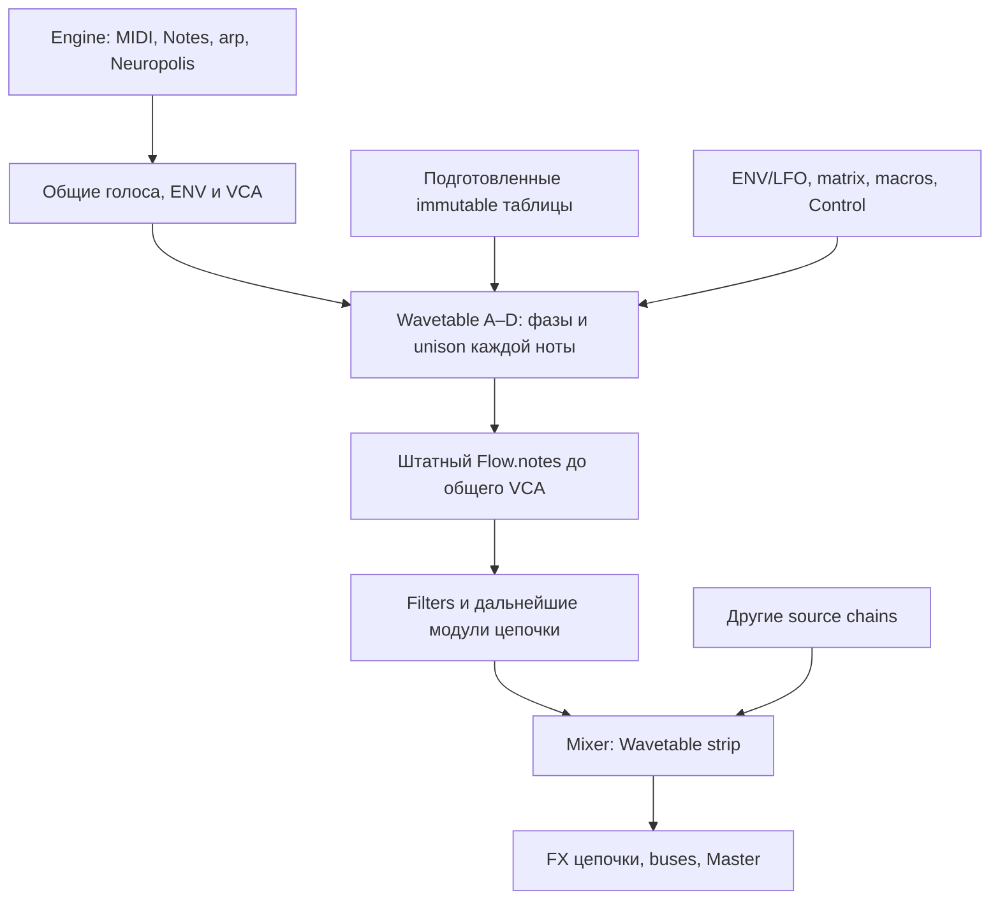

# PRD Wavetable движок внутри Rack SAD PET

Версия документа: 1.2 (A–D и комплексная библиотека). Дата: 30 октября 2026 года. Статус: реализация и проверка. База: `4c209ca3d6e6d0791cc09f6bb8929aaf5c9df72c` с текущими рабочими изменениями; текущая версия core — `0.34.2`.

**Добавить Wavetable как штатный источник существующего Rack.** Один модуль содержит от одного до четырёх независимо настраиваемых wavetable-осцилляторов A–D, играет существующими голосами Engine и передаёт их дальше по обычной цепочке. Первая стабильная версия включает качественное чтение и сканирование, unison, собственные таблицы, переносимые пресеты и общие инструменты модуляции SAD PET.

Обоснование алгоритмов, сравнение Ableton Wavetable, Serum 2, Vital, Surge XT и Phase Plant, первичные источники и результаты численного эксперимента находятся в [исследовании](WAVETABLE_RESEARCH.md). Этот PRD определяет требуемое поведение и план выпуска. Значения CPU, времени импорта и качества ниже — **проектные пороги приёмки, пока они не измерены на реализации**.

## 1. Задача продукта

Музыкант должен получать меняющийся во времени тембр из набора периодических волн и соединять его с существующими Filters, Grains, Resynth, FX и Mixer. Он выбирает таблицу, играет ноты, двигает Position или назначает модуляцию, сохраняет звук и открывает его в браузере либо DAW с тем же содержимым.

Главное отличие от существующего Synth — многокадровые таблицы и их музыкальное сканирование. Оно должно быть частью модульного инструмента: общие ноты, transport, ENV/LFO, macros, MIDI learn, Neuropolis и Control canvas остаются основными средствами управления.

### Целевые пользователи

| Пользователь | Нужный результат |
| --- | --- |
| Музыкант, собирающий Rack | Добавить движущийся источник рядом с Synth/Drums и обработать существующими модулями |
| Саунд-дизайнер | Управлять фазой, Position, A–D, unison и собственными таблицами; сохранять переносимые звуки |
| Исполнитель с MIDI-клавиатурой | Повторяемые атаки, sustain, bend, выразительное движение без выпадений звука |
| Пользователь телефона/планшета | Выбирать таблицу и редактировать основные ручки касанием без горизонтального скролла |
| Автор проекта в DAW | Автоматизировать стабильные параметры и восстановить проект без исходных файлов |

### Проверяемые результаты

1. Новый Wavetable-тембр готов к игре после одного добавления; не требует загруженного Sample или внешней библиотеки.
2. Sweep Position меняет тембр непрерывно; новые ноты могут запускать собственное движение через имеющиеся ENV.
3. Wavetable, Synth и Drums одновременно работают в одном Rack с предсказуемыми цепочками и Mixer.
4. Scene, `.sadinst` и DAW state переносят пользовательские таблицы вместе со звуком.
5. Обычные ручки и загрузка нового актива сохраняют звучащие ноты; старые проекты сохраняют прежнее поведение.
6. Качество и стоимость проверяются на реальном Rust/WASM-коде, в браузерах и в DAW до стабильного выпуска.

## 2. Границы первой версии

### Обязательный объём 1.0

- Один `Module::Wavetable` на Rack; от 1 до 4 WT-осцилляторов внутри него.
- До 32 музыкальных нот через текущий Engine allocator; 1–8 unison-осцилляторов на A–D.
- До 256 кадров, канонический период 2048 отсчётов, mono-таблицы; stereo получается через unison/pan.
- Выбор встроенных и пользовательских таблиц, непрерывный Position, tune, level, pan, phase/random phase, detune/spread.
- Общие ENV/LFO/macros/matrix, численные треки и Notes Neuropolis, MIDI learn, привязка к Control canvas.
- Независимый для каждой ноты Position ENV, использующий существующие огибающие Engine.
- Импорт подготовленных WAV-таблиц и одиночных периодов, экспорт таблицы, библиотека и Undo смены актива.
- Сохранение всех данных в сценах, instrument presets и DAW state; единое DSP-ядро для native и WASM.
- Factory-набор, измерения DSP/CPU/памяти, браузерная и DAW-проверка.

### Развитие после 1.0

| Этап | Возможности | Условие начала |
| --- | --- | --- |
| 1.1 | Ограниченный phase bend, PM B→A, дополнительные per-note источники модуляции | Базовое ядро прошло spectral/CPU gates; отдельные эталоны модулированного спектра |
| 1.2 | Audio→wavetable, Capture from Rack, выравнивание фаз, amplitude/phase spectral morph | Надёжны активы и recall; определены качество period tracking и обработка непериодического материала |
| 2.x | Редактор кадров/гармоник, offline modifiers, дополнительные форматы | Есть подтверждённые сценарии создания таблиц; определён отдельный интерфейс редактора |

В 1.0 не входят hard sync, audio-rate Position, cross-rack FM, wavefolding внутри осциллятора, полная MPE-матрица, stereo wavetables, произвольное число Wavetable-модулей и загрузка пресетов других синтезаторов. Существующие Rack-эффекты доступны сразу.

## 3. Пользовательские сценарии

| ID | Сценарий | Ожидаемое поведение |
| --- | --- | --- |
| U01 | `+ Timbre → Wavetable` | Создаётся Rack с Wavetable → Filters → Mixer → FX B; он ждёт ноты; добавлен и включён только A |
| U02 | `+ Module → Sources → Wavetable` в существующем Rack | Источник появляется в выбранном месте; исходные настройки MIDI gate/transport и другие источники сохраняются |
| U03 | Вращение Position при удержанной ноте | Звук проходит через таблицу, фаза ноты продолжается; настройка высоты не меняется |
| U04 | LFO 1 → A Position | Используется обычный выбор назначения; видны base и фактическое движение |
| U05 | Position ENV = ENV 2; две ноты с интервалом 200 ms | Каждая нота проходит свою ENV-траекторию Position, независимо от последней нажатой клавиши |
| U06 | Добавить B через + Wave, расстроить, добавить unison | Фазы уже звучащего A не перезапускаются; изменение числа unison происходит через fade |
| U07 | Перетащить подготовленный WAV на A | Таблица распознаётся, готовится вне аудиопотока и применяется с переходом; Sample-модуль не меняется |
| U08 | Импорт без достаточных метаданных | Показаны размер периода и число кадров; пользователь выбирает реальную интерпретацию, слышит preview и применяет её |
| U09 | Поменять таблицу на длинном аккорде | Аккорд продолжает звучать, Position сохраняет нормированную величину, смена данных не создаёт дополнительного скачка |
| U10 | Сохранить `.sadinst`, удалить исходный WAV, открыть в другом хосте | Таблица восстанавливается из встроенных канонических данных |
| U11 | Переместить Wavetable ниже Mixer | Источник играет рядом с суммой согласно текущему контракту Rack; история не пересоздаётся без причины |
| U12 | Wavetable → Grains | Grains читает историю цепочки, а не исходный WAV-актив таблицы |
| U13 | A Position в Neuropolis и на Control canvas | Один параметр имеет одинаковый ID, единицы и base value во всех представлениях |
| U14 | Открыть старую сцену без Wavetable | Новый источник не появляется и не расходует runtime-память таблиц |

### Дополнение: до четырёх волн (запрос пользователя)

| ID | Сценарий | Ожидаемое поведение |
| --- | --- | --- |
| W01 | Добавлять волны | Новый Rack содержит A; + Wave последовательно добавляет B/C/D, максимум 4 |
| W02 | Независимое управление | У A–D собственные table, Position, transpose/fine, level/pan, phase/random, unison/detune/spread, Position ENV |
| W03 | Удалять волны | Можно удалить любую из 2–4 волн; оставшиеся сдвигаются, последняя волна сохраняется |
| W04 | Сохранить/восстановить | Сцена, .sadinst и DAW сохраняют count и все четыре набора настроек; старые A/B загружаются без изменения звука |
| W05 | Управлять из хоста | C/D поддерживают host automation, modulation, Neuropolis и Control так же, как A/B; прежние parameter IDs и индексы сохранены |

Четыре слоя входят в тот же Wavetable source, используют общие голоса и один Mixer strip. Новый слой стартует с Basic Morph и level=0.65; добавление и удаление не перезапускает удержанные ноты. Fade и перерасчёт банков соблюдают те же realtime-границы.

## 4. Архитектура Rack

### 4.1 Границы ответственности



Это типичный порядок. При перемещении модулей применяется существующий `rack::Plan`; новое ядро не навязывает собственную последовательность фильтров и эффектов.

| ID | Требование | Приёмка |
| --- | --- | --- |
| R01 | `Module::Wavetable` является source, имеет label и стабильный snake_case ключ `wavetable` | Rust/JS строят одинаковые планы; `source()` возвращает true |
| R02 | Wavetable стартует per-note flow как Synth | Filters непосредственно в его полифонической части получают отдельный сигнал каждой ноты |
| R03 | Runtime возвращает сигнал **до** Engine VCA | Одно применение огибающей; сравнение с ручным VCA-эталоном |
| R04 | После collapse источник обрабатывается штатными общими модулями | Resynth, FX, EQ, Grains и taps соответствуют существующей семантике; нет второго частного FX rack |
| R05 | В Mixer появляется седьмой source strip, после имеющихся шести | Level, pan, mute, solo, meter; прежние strip indexes сохраняются |
| R06 | Ниже Mixer источник следует текущему правилу вывода рядом с суммой | Не применять к нему выдуманную дополнительную Mixer-маршрутизацию |
| R07 | Модуль поддерживает move, fold, power, remove и Undo | Порядок сохраняется; Undo возвращает настройки и ссылки на активы |
| R08 | Удаление Wavetable не удаляет общие ENV/LFO/notes и другие source chains | Соседние источники продолжают работать |
| R09 | Модуль безвреден для Rack без Wavetable | `Option` runtime отсутствует; нет фонового рендера и загрузки factory-таблиц |
| R10 | Расширение `rack_peaks` с 6 до 7 согласовано во всех binary telemetry/pack decoders | Версия/длина пакета проверяются; Worker, Worklet и UI одной сборки не читают старую раскладку как новую |

Новый shortcut в `timbres::Kind` может служить команде создания, как у 303 Bass. Сохранённый инструмент определяется как `kind: rack` с `module: wavetable`; отдельная ветка standalone-синтезатора не нужна.

### 4.2 Ноты и transport

- Wavetable использует `index`, `generation`, `note`, `channel`, `velocity` существующего голоса. Частота учитывает его bend и общий tune по правилам voiced sources проекта.
- Новый Wavetable-тембр ждёт ноты. Простое Play не создаёт новый drone-контракт.
- При добавлении модуля в уже существующий Rack он следует его текущему MIDI gate и свободному голосу 0, если этот режим выбран пользователем. Добавление источника не меняет transport всей сцены.
- Notes, sustain, note-off, Stop/All Notes Off, voice stealing и release берутся из текущего Engine. Не создавать второй список удержанных нот или второе толкование sustain.
- У каждой ноты свои фазы A–D/unison. Обычное изменение параметров не меняет `generation`.
- При power off выход гасится за 5 ms, после чего фазы можно заморозить; общие ENV продолжают жить. При включении звук входит за 5 ms; если generation изменился, фазы инициализируются для новой ноты.
- Reorder не считается новым note-on. Freeze/Reverse сохраняют своё текущее значение для соответствующих Rack-стадий и не начинают неожиданно обращать фазу WT.
- Независимые amp-envelope, MIDI channel и keyboard split между A–D либо между Synth/WT одного Rack не вводятся. Для независимых партий используются отдельные timbres.

## 5. Модель данных и состояние

### 5.1 Settings, активы и runtime

Предлагаемые структуры; конкретные Rust-имена можно уточнить при реализации без изменения контрактов:

```text
wavetable::Settings
  schema_version: 2
  engine_revision: 1
  seed: decimal u64 string (без потери точности в JavaScript)
  count: 1..4
  oscillators: [OscillatorSettings; 4]

OscillatorSettings
  enabled, asset_id, position, transpose, fine, level, pan
  phase, phase_random, unison, detune, spread
  position_env, position_env_depth

WavetableAsset
  id, content_hash, name, author, license/provenance
  canonical_version, frame_count, frame_size=2048
  canonical_f32_le_bytes
  source/import recipe, compiler_version

dsp::wavetable::Prepared
  resolved asset handles and compiled banks
  preallocated state for every Engine voice × 4 oscillators × 8 unison

dsp::wavetable::Runtime
  active/transition bank handles
  phases, generation, ramps, short transition state
```

`Preset` получает опциональные `wavetable` settings и несериализуемый prepared runtime по текущему шаблону Synth/Sampler. Settings не содержат копии таблиц. Пул активов принадлежит владельцу сцены/контрольному слою; подготовка разрешает asset IDs **до** передачи в Engine. Хеширование, поиск по пулу и восстановление файлов не выполняются в render.

Числовая конфигурация отделена от структурных изменений. Изменение Position/level не запускает FFT и полный `prepared_clone_for`. Смена asset готовит новый bank. Смена sample rate обновляет частотные коэффициенты и переходы без повреждения настроек и без перекомпиляции канонического периода как обычного аудиофайла.

### 5.2 Идентичность и версии

| ID | Требование |
| --- | --- |
| S01 | Пользовательский asset идентифицируется SHA-256 от versioned canonical header и f32 LE данных; название/путь не входят в идентичность звука |
| S02 | Factory ID включает неизменяемую ревизию, например `factory:wt-basic-morph:v1`; новый звук получает новый ID |
| S03 | Канонические данные однозначны: порядок кадров/отсчётов, f32 LE, отсутствие NaN/Inf, канонизация −0 перед хешированием |
| S04 | Compile-cache key включает content hash, compiler revision, layout/kernel revision; file timestamp не является ключом |
| S05 | `engine_revision` фиксирует звуковую семантику: gain law, interpolation и smoothing. Изменение звука старого патча требует явной новой ревизии/миграции |
| S06 | Derived mips можно пересоздать; одинаковый канонический asset не должен занимать отдельную копию на каждую ноту |
| S07 | Пользовательская таблица не меняется при замене/переименовании её исходного файла |
| S08 | Пропавший актив не заменяется произвольной похожей таблицей; при интерактивной смене сохраняется прежний звук, при restore выдаётся конкретная ошибка |

SHA-256 канонического результата не обещает, что разные импортеры/FFT-backends создадут одинаковые bytes из любого исходника. Для переносимого recall сохраняются **готовые канонические данные**; recipe нужен для воспроизводимой повторной обработки и диагностики.

### 5.3 Форматы сохранения

- Scene: manifest всех используемых WT-активов с дедупликацией по hash; данные встроены в экспорт. Несколько слоёв или timbres с одинаковой таблицей используют одну запись.
- `.sadinst`: настройки одного Rack и все его пользовательские WT-активы; не требуется доступ к библиотеке отправителя.
- DAW state: все используемые пользовательские данные встроены; пути к локальным файлам служат только происхождением. Restore готовит банки до запуска звучания нового состояния.
- Library: native хранит пользовательские таблицы отдельно от factory-ресурсов; browser — IndexedDB. Удаление записи библиотеки не ломает уже сохранённый переносимый проект.
- Factory tables: поставляются с приложением/статическим сайтом, без логина и сетевой загрузки при note-on. Банк загружается по необходимости; каталог не декодирует все таблицы заранее.
- Таблица экспортируется как WAV с явно указанным размером периода 2048 в сопровождающей информации; поддерживаемый `clm ` writer добавляется только после round-trip проверки с fixture. Настройки звука экспортируются через `.sadinst`.
- После Save → Close → Load должны совпадать canonical hash, A–D settings, routes, phase seed и версия алгоритма. Фаза звучащей посреди ноты не является новым форматом сохранения DAW: восстановленный transport/note lifecycle следует текущему хосту.

### 5.4 Миграции

Формат WT schema 1 с двумя осцилляторами мигрирует в schema 2/count=2 без изменения A/B, seed и engine revision. У нового модуля count=1. Удаление волны сдвигает последующие настройки влево; host automation остаётся привязанной к буквенным слотам. Параметры C/D дописываются после уже существующих A/B и WT strip: весь прежний префикс из 4304 параметров остаётся на месте.

Старый preset без `wavetable` остаётся без источника. `Preset::sanitize` создаёт defaults только при наличии `Module::Wavetable` и удаляет orphan settings при его отсутствии по текущему правилу Rack. UI Undo держит удалённые настройки и активы отдельно до завершения окна отмены.

Новые переносимые файлы получают minimum-engine/capability marker. Новый loader проверяет его до частичного применения; неподдерживаемые версии отклоняются без перезаписи исходного файла. Совместимость новых WT-проектов со старым бинарником не обещается: старый enum Module не знает новый источник. Это должно быть явно указано в release notes. Перед изменением autosave-формата сохраняется последняя успешно прочитанная версия; неуспешная загрузка не запускает автосохранение поверх неё.

## 6. Контракт DSP

### 6.1 Частота и фаза

```text
f = 440 × 2^((note + bend + common_tune + transpose − 69 + fine/100)/12)
phase[n+1] = fract(phase[n] + f/Fs)
```

`common_tune` должен следовать действующему voiced-source контракту, включая sample_tune. Main pitch/Grain pitch не переопределяется как глобальный WT transpose. Для отдельного перемещения A–D добавляются явные WT pitch targets/lanes; существующие `Main pitch → OSC 1–4` не меняют смысла.

Предпочтителен f64 либо подходящий fixed-point phase accumulator; буферы — f32. Точность accumulator и SIMD-вариант проверяются по Q01/Q03. Несуществующие частоты не заворачиваются в слышимый диапазон: выход плавно уменьшается от `0.42×Fs` к нулю при `0.45×Fs`; выше он остаётся нулевым, а phase lifecycle остаётся определённым. На очень низких частотах используется наиболее богатый доступный bank; исходных гармоник больше 1023 первая ревизия не создаёт.

Начальная фаза:

```text
phase_start = fract(phase_setting + phase_random × random01(seed,note_on,osc,lane))
```

При random=0 атаки повторяемы. При random=1 начальные фазы равномерны. Случайные значения создаются по детерминированной последовательности note-on, а не по системным часам или размеру аудиоблока.

### 6.2 Таблицы и чтение

1. Вне аудиопотока: декодирование → определение кадров → периодическое приведение к 2048 → удаление DC → общий gain при необходимости → канонический asset.
2. FFT каждого канонического кадра, построение bandlimited levels, IFFT с корректным scale, создание периодических guard samples.
3. Caps первого кандидата: `1023,511,255,127,63,31,15,7,3,1`.
4. Кандидат длины уровня: `max(64,4×(H+1))`; последний уровень также имеет минимум 64 отсчёта.
5. Кандидат реконструкции: 16-point Blackman-windowed sinc; коэффициенты заранее подготовлены, например в polyphase-таблице с интерполяцией коэффициентов. Trig, FFT и построение kernel в render запрещены.
6. В текущей фазе читаются соседние кадры, затем выполняется linear frame interpolation. На переходе mip читаются допустимые уровни с одной и той же нормированной фазой.

Это **кандидат для M0** по результатам 96 offline-случаев, а не окончательно оптимизированный DSP. Сначала измерить Rust scalar/WASM и f32/polyphase-погрешность. Compact8+sinc8 либо другой kernel допускается выбрать только при выполнении тех же Q-порогов и бюджета памяти. Один факт «он быстрее» не является основанием снизить качество неявно.

Если кандидат не укладывается в сроки callback, M0 должен выбрать другое сочетание density/kernel, уменьшить заявленный рекомендуемый рабочий профиль до beta либо отложить выпуск. Решение и новые измерения фиксируются в исследовании до написания factory presets.

### 6.3 Переходы mip

Для уровня с cap H безопасная граница `f_safe=0.45×Fs/H`. Рабочая гипотеза fade-зоны — последние 20% диапазона до этой границы: от `0.8×f_safe` до `f_safe`. Обе участвующие таблицы безопасны во всей зоне. Смешивание не должно оставлять вес богатого уровня выше его границы.

Эта octave-сетка может давать слышимые изменения яркости даже при непрерывном переходе. M0 сравнивает её с более плотными caps и фиксирует закон до beta. Не нормализовать уровни по отдельности. Смена направления bend/glide не должна вызывать дребезг между уровнями. Для быстрого скачка вверх запрещено доигрывать небезопасный старый mip ради fade.

### 6.4 Управление и сглаживание

| Источник изменения | Поведение первой ревизии |
| --- | --- |
| Ручка/host automation: Position, tune, gain, pan, detune, spread | Предлагаемый dezipper 2 ms, время задаётся в секундах и не зависит от Fs |
| Общий control tick Engine | Восстановление значений между ticks на каждом аудиоотсчёте; не оставлять zero-order hold по 32 samples |
| Position ENV | Читать локальные `Voice.env_values` и восстанавливать их движение; не добавлять вторую ADSR |
| Ступень Neuropolis без slide | Намеренная ступень с коротким тем же dezipper; не превращать её в длинный sweep |
| Neuropolis slide | Следовать заданной траектории; не накладывать второй длинный glide |
| Enabled/power/unison count | Предварительно выделенные состояния, fade 5 ms, без reset всего голоса |
| Смена asset | Crossfade 20 ms; тот же normalized Position и phase; не применять чужие частоты/фазы |

Точные времена 2/5/20 ms закрепляются после прослушивания M0. Они сохраняются как поведение `engine_revision=1`, а не меняются произвольно в patch update.

Одинаковая таблица, загруженная повторно под тем же hash, не создаёт звуковой переход и не сбрасывает фазы. Если импорт пришёл во время текущего crossfade, новый переход начинается после завершения текущего; очередь хранит только последнее ожидающее намерение.

### 6.5 Уровень, unison и stereo

- Каждый входной кадр имеет удалённый DC; канонический общий gain не меняется между кадрами.
- После смешивания unison применяется `1/U`. При одинаковых фазах и detune=0 смена U не меняет стационарный уровень.
- Detune симметричен относительно ноты в cents; U=1 означает отсутствие unison-detune и spread. Для чётного U нет обязательного центрального lane, для нечётного он есть.
- Pan и spread используют явный согласованный stereo gain law; центр соответствует текущему интерфейсному значению pan=0.5. Spread=0 даёт mono-сумму до layer pan.
- Предлагаемый масштаб исходного осциллятора — peak 0.5 при peak=1 таблицы, level=1, U=1 и полном Engine VCA; это соответствует порядку уровня существующего Synth. Финальную калибровку закрепить до factory presets.
- Два слоя суммируются линейно. Внутри осциллятора нет скрытого limiter, saturation или автоматической RMS-нормализации. Сценой управляет существующий Master/output stage.
- При выключении слышимого слоя его фаза не должна менять фазу другого. Нулевой level позволяет пропускать работу после fade, если слой не используется как будущий modulation source; в 1.0 аудиочастотных ссылок между A–D нет.

## 7. Модуляции и автоматизация

### 7.1 Общая и индивидуальная модуляция

Общие LFO, macros, численные треки и матрица продолжают изменять timbre-level значения. Для Position добавляется знакомый по Filters механизм `ENV` + `ENV DEPTH`, использующий одну из уже существующих ENV 1–8 для **каждого голоса**:

```text
p_voice = clamp(p_base + delta_shared + env_depth × voice.env_values[env], 0, 1)
```

При `ENV=Off` индивидуальная часть равна нулю; при удалённой ENV — также ноль с сохранением безопасной настройки. В первой ревизии локальная ENV unipolar; отрицательная depth двигает Position в обратном направлении. Сначала суммируются вклады WT-position, затем выполняется один clamp. Специальная ветка не должна случайно применить общий ENV-вклад второй раз; намеренно назначенные пользователем общий и локальный маршруты остаются независимыми.

Матрица Velocity/KeyTrack/Aftertouch остаётся с текущим timbre-контекстом. Нельзя выдавать её за polyphonic MPE. Amp velocity и per-channel bend, уже поддержанные Engine, сохраняются. В 1.1 можно добавить opt-in scope для WT-маршрутов; отсутствие scope у старых маршрутов обязано означать прежнюю общую семантику.

### 7.2 Реестр параметров

| Группа | Предлагаемые ID | Host/MIDI learn | LFO/matrix/Neuropolis |
| --- | --- | --- | --- |
| A–D continuous | `wt_a_position`, `_transpose`, `_fine`, `_level`, `_pan`, `_phase`, `_phase_random`, `_detune`, `_spread`, `_env_depth`; аналогично `wt_b_…`, `wt_c_…`, `wt_d_…` | Да | Position/tune/level/pan/detune/spread/env_depth — да; start phase/random относятся к следующему note-on |
| A–D stepped | `wt_a_enabled`, `_unison`, `_env`; аналогично B/C/D | Да, stepped | Число unison и ENV selection не являются audio/control-rate modulation destinations в 1.0 |
| Mixer | `rack_wavetable_level`, `_pan`, `_mute`, `_solo` | Да | Как существующие Rack strips |
| Asset | `asset_id` в settings | Структурная команда, не индекс файла в host list | Нет |
| Engine | `seed`, `engine_revision` | Состояние пресета | Нет |

Префикс имён — предложение; финальный список закрепляется одним registry snapshot до публичной beta. Произвольные числовые host ID в этом PRD не назначаются.

| Параметр | Диапазон | Default |
| --- | --- | --- |
| Position | 0…1, отображение 0…100% и номер кадра при точном выборе | 0 |
| Transpose | −48…+48 semitones; UI шаг 1, modulation может быть непрерывной | 0 |
| Fine | −100…+100 cents | 0 |
| Level | 0…1 amplitude, отображение % по общему UI-контракту | A=1; добавляемые B/C/D=0.65 |
| Pan | 0…1 | 0.5 |
| Phase | 0…1 cycle, отображение градусов | 0 |
| Phase random | 0…1 | 0 |
| Unison | 1…8 integer | 1 |
| Detune | 0…100 cents, крайние lanes симметричны | 10; при U=1 не действует |
| Spread | 0…1 | 1; при U=1 не действует |
| Position ENV | Off / ENV 1…8 | Off |
| ENV depth | −1…+1 от полной шкалы Position | 0 |

Новая группа дописывается **после всего текущего массива specs**, включая новые WT strip controls. Нельзя расширить старый цикл регистрации так, чтобы он сдвинул следующие ID. Snapshot сравнивает `id`, числовой индекс, min/max, default и stepped semantics всего прежнего префикса.

DAW automation в текущем проекте привязана к первому host timbre slot; остальные timbres получают свои внутренние модуляции/Control. 1.0 наследует это ограничение. Wavetable в первом slot должен полностью автоматизироваться; размещение в другом slot не означает создание нового host parameter namespace.

### 7.3 Интерфейс модуляции

Новые ручки используют существующие context menu, MIDI learn, macro assignment и `data-control-key`. На Control canvas можно перенести отдельную ручку или карточку. Neuropolis получает явные A–D pitch offsets и численные назначения WT; они не подменяют уже сохранённые Synth/Resynth oscillator destinations.

Индикатор Position показывает base и фактическое значение последнего активного голоса; для нескольких нот добавляется компактный диапазон min/max. Общий marker нельзя выдавать за точное положение всех голосов. Предпросмотр волн получает сокращённые данные из worker/cache; UI не читает или сериализует весь bank каждый telemetry tick.

## 8. Импорт, экспорт и библиотека

### 8.1 Поддерживаемый вход

| ID | Требование | Поведение |
| --- | --- | --- |
| I01 | RIFF/WAVE PCM16/24/32 integer и IEEE float32 | Проверка fmt/data, границ chunks, padding, размеров и числа отсчётов до декодирования |
| I02 | 1–256 кадров; входной период 128/256/512/1024/2048/4096 samples | Каждый кадр приводится периодическим bandlimited resampling к 2048; при уменьшении размера лишние гармоники удаляются |
| I03 | Mono или выбор канала stereo | Mono проходит сразу; stereo предлагает Left/Right/Mix с прослушиванием, без скрытого суммирования |
| I04 | Поддерживаемая metadata `clm ` или явный размер периода | Разбор только проверенных вариантов; malformed chunk не меняет границы чтения за пределами файла |
| I05 | Неоднозначный файл | Компактный импортный диалог показывает Frame size, Frames, канал и preview; Apply подтверждает выбранную интерпретацию |
| I06 | Подготовленный однозначный файл | Применение без лишнего подтверждения, с Undo; при ошибке продолжает играть прежний asset |
| I07 | Лимит входа 16 MiB, проверка decompressed размеров | Превышение отклоняется до больших выделений; финальные канонические данные ≤2 MiB на таблицу |
| I08 | Пустые/некорректные/NaN/Inf данные | Пустой контейнер и неконечные значения отклоняются; корректная волна тишины остаётся допустимой, нормализация не делит на ноль |
| I09 | Число frames не получается целым либо превышает 256 | Явная ошибка с найденными параметрами; без молчаливого отбрасывания последнего кадра или половины таблицы |
| I10 | Заголовочный sample rate | Не задаёт строй подготовленного single-cycle; воспринимается как происхождение, высоту задаёт phase increment |

RF64, compressed WAV, FLAC, AIFF, `.wt`, `.uhm`, `.vital` и preset-файлы сторонних синтезаторов в 1.0 не заявляются. Если существующая WAV-библиотека не читает нужный RIFF chunk, перед ней нужен ограниченный metadata parser; полный новый универсальный audio decoder не требуется.

### 8.2 Обработка импорта

Порядок фиксируется в compiler revision:

1. Проверить размеры и формат; декодировать выбранный канал в конечные значения.
2. Определить границы периодов из валидной metadata или явного выбора. Не выполнять pitch tracking готового wavetable автоматически.
3. Привести каждый период к 2048 с периодическим продолжением; обычный resampler конечного файла с zero-padding у краёв не подходит.
4. Удалить среднее значение каждого кадра. Сохранить фазовые отношения и относительные уровни кадров.
5. Общий peak gain: при peak>1 ослабить всю таблицу до 1; при peak≤1 оставить уровень. Не поднимать автоматически почти пустые данные.
6. Создать canonical header/bytes/hash, записать recipe и происхождение.
7. Построить mips и preview; сохранить в библиотеку только после успешного завершения.

Обрезание краёв, windowing, phase alignment, покадровая RMS-нормализация и «починка» скачка периода не выполняются скрыто. Подготовленная saw имеет намеренный разрыв; принудительное склеивание концов изменит её спектр. Для обычного аудио пользователь получит понятный выбор «импорт подготовленной таблицы»; полноценная конвертация записи появится отдельным этапом.

### 8.3 Библиотека

- Категории Factory/User, поиск по названию/тегу, предыдущая/следующая таблица; выбор активного A–D всегда очевиден.
- Rename меняет метаданные, сохраняя идентичность звука. Новая обработанная версия получает новый content hash.
- Повторный импорт одинаковых canonical bytes использует существующие данные; допускаются несколько названий/записей библиотеки.
- Удаление User-записи имеет Undo/Trash по действующему паттерну проекта. Factory-таблицы не редактируются на месте.
- Export WAV сохраняет кадры в исходном порядке. Export instrument включает настройки, маршруты и пользовательские активы.
- Декодирование и поиск не требуют сети. Нет загрузки контента в облако или внешнего сервиса анализа.

## 9. Потоки и обновление во время игры

### 9.1 Native

```text
UI/control owner
  → validate request + assign generation
  → decode/compile/cache off audio thread
  → prepared update in existing bounded command queue
Audio owner
  → check timbre/oscillator/generation
  → install handles at block boundary
  → crossfade using preallocated voice state
  → return old handles through retirement queue
Control owner
  → release buffers and finish library/save bookkeeping
```

Runtime сохраняет фазы, generation, ENV lifecycle и сглаженные значения при совместимых обновлениях. Не считать `Arc` автоматически безопасным: освобождение последней ссылки и деструктор большого bank запрещены в callback. Ресурсы остаются у контрольного владельца/retirement slot до безопасного освобождения.

### 9.2 WASM и AudioWorklet

Worker готовит packed bank, затем передаёт его в staging протокол. Worklet и Worker имеют разные heaps; нельзя отправить адрес Rust Vec из одного в другой. Передача ArrayBuffer устраняет JS-копию между потоками, но принятие данных в WASM всё равно нужно спланировать.

Для больших WT-банков нужно повторить **схему ограниченных порций**, уже существующую для Source FX: [worklet.mjs](../wasm/web/worklet.mjs), `source-load`, строка 115; [core.mjs](../wasm/web/core.mjs), `sourceChunk`, строка 164. Там есть 32 KiB transport chunk. Это образец, не доказательство, что текущий source loader уже подходит новым таблицам.

В M0 требуется проверить и закрепить конкретный вариант staging:

- Начальный кандидат — отдельный arena для compiled WT-данных в аудио-WASM, резервируемый до начала live rendering; плановая ёмкость 64 MiB. Канонические исходники остаются у Worker/control owner.
- Память под новый bank берётся из arena без вызова общего allocator и `memory.grow` во время воспроизведения. Возврат bank освобождает arena slot, не большой системный heap-блок.
- Copy/staging идёт частями с общим бюджетом не более 10% render deadline; 32 KiB — верхний стартовый размер порции, а не обязательная работа в каждом quantum. Размер уточняется по измерениям.
- После полного checksum/descriptor validation переключаются заранее готовые handles; GUI получает acknowledgement именно установки, а не только завершения FFT в Worker.
- Не создавать большие TypedArray/JSON-представления на каждом process; views переиспользуются. Сообщение Worklet не выполняет один большой memcpy/deserialize под видом «вне process».
- Глобальный reserve учитывается отдельно в startup/memory-профиле, в том числе у сцен без WT. R09 требует отсутствия bank/voice runtime на тембр, но не скрывает стоимость общего arena.
- Если резервировать такой объём на целевых устройствах нельзя, M0 обязан выбрать и измерить другой ограниченный механизм до интеграции. Синхронная загрузка десятков MiB в Worklet не является допустимым обходом.

Нельзя ставить весь render на Worker и синхронно ждать его по каждой ноте. Не вводить SharedArrayBuffer/COOP/COEP как новое обязательное условие сайта ради первой версии.

### 9.3 Отмена, очереди и ошибки

| ID | Требование |
| --- | --- |
| RT01 | Во время live render: 0 alloc/realloc/free, блокировок, file/network I/O, FFT и сериализации в аудиопути |
| RT02 | Это ограничение распространяется на note-on, numeric automation, asset commit, crossfade completion, remove/reorder и retirement |
| RT03 | На осциллятор одновременно не более active+transition bank; ожидающая смена coalesce до последнего запроса |
| RT04 | Каждый job имеет scene/timbre/oscillator generation; старый результат не применяется к новому тембру либо удалённому модулю |
| RT05 | Пока данные готовятся, старый bank звучит; для первого включения до готовности нового источника он молчит, остальные timbres продолжают играть |
| RT06 | Cancel, memory-limit и decode-error не изменяют прежнее состояние; промежуточная библиотечная запись не остаётся как готовый asset |
| RT07 | При заполнении очереди control owner объединяет новые команды или сообщает о невозможности операции; callback не ждёт и не освобождает накопленные банки |
| RT08 | Restore/scene swap применяются как цельное подготовленное состояние; при ошибке не остаётся половина нового Rack |
| RT09 | Asset selection и параметры принимаются через существующие хостовые границы; UI не держит частный источник истины о звучащем asset |

Предлагаемые команды: catalog/import/prepare/status/assign/export и sparse `/api/parameters`. Точные URL и WASM ABI проектируются рядом с текущими инструментами; поля descriptor, bounds, generation и ownership входят в контракт независимо от их имён. Пакеты preparation не являются публичным совместимым файловым форматом.

## 10. Интерфейс

### 10.1 Карточка в Rack

Шапка использует действующие power, move, fold, remove и цвет source chain. Внутри:

1. Кнопка **+ Wave** добавляет следующий слой A–D. У каждой волны есть power и Remove. На широком экране — сетка из двух равных колонок; на телефоне — вкладки существующих волн, по одной карточке. После четвёртой волны + Wave недоступна. Последнюю волну удалить нельзя.
2. Название текущей таблицы, previous/next, выбор библиотеки и Import в том же месте.
3. Основная waveform выбранного кадра и несколько соседних frames; Position доступен отдельной ручкой/slider и перетаскиванием по изображению.
4. Главный ряд: Position, Tune, Level, Pan; второй — Unison, Detune, Spread.
5. Дополнительная область Phase/Random и Position ENV/Depth. ENV selector ведёт к существующей ENV, без второго ADSR-редактора.

Init: одна волна A играет первый кадр `Basic Morph v1` — saw; B/C/D добавляются пользователем; без LFO, unison и эффектов внутри источника. Новый тембр может иметь нейтральные/выключенные Rack FX; он должен дать сухую понятную отправную точку, а не скрытый showcase-патч.

Визуализация не изображает выход после фильтра как исходную таблицу. Base Position и modulation overlay различаются. Форма строится из preview-кэша; 3D-анимация не обязательна и не должна занимать аудиобюджет.

### 10.2 Мобильный и клавиатурный сценарий

| ID | Требование |
| --- | --- |
| UI01 | На ширине 360/390 px нет горизонтального скролла всей страницы; A–D редактируются по одному, без слишком мелких двух колонок |
| UI02 | Элементы одного ряда имеют одинаковую высоту; общий grid и существующие размеры проекта используются повторно |
| UI03 | Touch targets основных действий не меньше 44×44 CSS px; вертикальный скролл не блокируется декоративным canvas |
| UI04 | Position, tune и level можно менять без hover, right-click, wheel или drag-and-drop |
| UI05 | Есть клавиатурный фокус, стрелки/числовое редактирование, accessible names и значения в реальных единицах |
| UI06 | В библиотеке и импортном диалоге фокус сохраняется/возвращается; закрытие не теряет текущую таблицу |
| UI07 | Ошибка показывается рядом с действием и называет причину: format, frame size, length, missing asset, memory. Нет технических stack traces в основном потоке |
| UI08 | Fold/переключение A–D не прерывают звук и не сбрасывают viewport; снижается только работа отображения |
| UI09 | Loading относится к конкретному asset; после ошибки остаются прежние имя/волна/настройки, без ложного отображения незвучащей таблицы |

Проверять не только headless DOM: реальные screenshots desktop/mobile, касание или pointer-сценарий, клавиатуру и встроенный editor native plugin. Отдельный touch-тест включает import через file picker, поиск и назначение модуляции.

## 11. Бюджеты производительности и памяти

До конца M0 фиксируются конкретные модели/ОС/браузеры reference-устройств. Предлагаемые классы: Apple M1/M2 laptop, массовый x86-64 Windows laptop, iPhone класса 12/13 и Android класса Pixel 6. Эти устройства **не были протестированы в текущем исследовании**. В отчёте указывать CPU, RAM, ОС, browser/host version, commit, flags, scalar/SIMD и энергорежим; название «desktop» само по себе не даёт воспроизводимого результата.

### 11.1 Render

Deadline блока: `block_frames/Fs`. При 48 kHz и 128 frames — 2.667 ms. Измеряется дополнительный путь WT в реальном хосте; нейтральный Rack и общая нагрузка сцены также записываются. Для p99 — минимум 60 секунд после прогрева; для glitch/утечек — отдельная 30-минутная сессия с меняющимися активами.

| ID | Reference profile | Цель |
| --- | --- | --- |
| P01 | Desktop: 32 ноты × A/B (2 слоя) × U=1, 48 kHz/128 | p99 WT path ≤25% deadline; нет underrun в контрольной сессии |
| P02 | Desktop: 16 нот × A/B (2 слоя) × U=4, 48 kHz/128 | p99 WT path ≤40% deadline |
| P03 | Mobile browser: 8 нот × A/B (2 слоя) × U=2, 48 kHz/128 или фактический quantum | p99 WT path ≤40% deadline |
| P04 | Asset staging во время P02/P03 | Общая добавочная работа staging ≤10% deadline; нет пропуска quantum по причине переключения |
| P05 | Работа без WT | Сохранённые источники не получают новых циклов обработки WT; overhead сравнивается с baseline с учётом шума измерений |
| P06 | Максимум 32×4×8 | Измерить стоимость и стабильность отдельно; не выдавать этот stress-profile за гарантированный профиль любого телефона |

Четыре активные волны измеряются отдельно: P14 = 32×4×1, P15 = 16×4×4, P16 = 8×4×2 (mobile). Для desktop исходные цели: P14 ≤50% deadline, P15 ≤70%; мобильный лимит уточняется на reference device. Нельзя подменять замер четырёх волн результатом двух.

Сценарии P01–P03 являются условиями выпуска на выбранных reference-устройствах. Нельзя во время нагрузки незаметно уменьшать unison, менять asset либо обрывать голоса. При фактическом перегрузе действуют существующий DSP meter и управление нагрузкой пользователем. Экспорт использует тот же WT quality/engine revision, без скрытой смены kernel.

### 11.2 Подготовка и память

| ID | Операция | Цель |
| --- | --- | --- |
| P07 | Импорт 64×2048 mono на desktop | p95 compile-to-ready ≤500 ms, отдельно от выбора файла |
| P08 | Максимальная таблица 256×2048 | p95 ≤2 s desktop / ≤5 s mobile; старое аудио играет во время подготовки |
| P09 | Canonical + compiled bank одной максимальной таблицы | Цель ≤12 MiB без общих scratch/arena reserves; кандидат из исследования — 10.125 MiB до guards |
| P10 | Bank sharing | Число копий не зависит от числа MIDI/unison голосов; A–D с одним hash разделяют bank в одном heap |
| P11 | Browser WT working set | Начальный общий лимит 128 MiB, включая WT arena, Worker banks, canonical и переходные данные; уточнить по M0 с реальным ownership |
| P12 | Native WT working set | Начальный лимит 256 MiB с явным preflight и LRU только для неиспользуемого кэша |
| P13 | 1000 переключений таблиц/отмен jobs | После retirement память выходит на плато; нет роста пропорционально числу переключений |

Лимит относится к WT-подсистеме, а не ко всей сцене с samples/grains/voices. Активные и сохраняемые referenced assets не вытесняются так, чтобы потерять звук. Если новая сцена/таблица превышает лимит, подготовка целиком отклоняется до замены старого состояния. Пик рассчитывается до import/restore, с место́м под старый bank и переход; LRU не является разрешением на освобождение из callback.

Формат 2048×256 — верхний предел, а не обязательный размер factory-контента. Для большинства таблиц планировать 32–64 содержательных кадра; дублирование одинаковых кадров ради числа не создаёт качества.

## 12. Критерии качества звука

Пороги этого раздела — требования к будущему коду. Значения из Python-опыта подтверждают только статическую осуществимость одного кандидата. Численные сравнения используют определённый эталон, одинаковый уровень и согласованную полосу; аудиовыход всей FX-цепочки не используется для оценки чистоты изолированного осциллятора.

| ID | Проверка | Порог/ожидаемый результат |
| --- | --- | --- |
| Q01 | Строй U=1, MIDI 12…120, поддержанные Fs | Ошибка <0.1 cent там, где фундамент ниже high-frequency fade |
| Q02 | Статические saw/square/triangle, random-phase harmonic tables и sparse high partial | Паразитная энергия вне ожидаемого спектра ≤−70 dBr; полная ошибка реконструкции ≤−60 dBr на закреплённом корпусе |
| Q03 | Повторные ноты с phase random=0 | Совпадающий onset при одинаковом input/event stream; phase не зависит от block size |
| Q04 | Phase random=1 | Воспроизводимость по seed и отсутствие одинаковых фаз всех lanes по ошибке; распределение проверяется отдельно |
| Q05 | Position=0/1, F=1/2/256 и границы кадров | Точное соответствие первой/последней волне; без чтения за границами и wrap последнего кадра |
| Q06 | Медленное и быстрое сканирование 0.1/1/20 Hz | Сравнение с oversampled/аналитическим oracle; residual ≤−50 dBr в согласованной слышимой полосе; отдельно прослушать атаки и смены направлений |
| Q07 | Bend/glide через каждую границу mip | Нет скачка состояния; амплитуды общих гармоник сохраняются; яркость меняется по зафиксированному закону |
| Q08 | Смена одного и того же asset | Разница против непрерывного рендера ≤−100 dBFS; note lifecycle не сбрасывается |
| Q09 | Смена разных assets, enabled/unison и edits | Совпадение с заданным fade-oracle; нет дополнительного импульса сверх музыкального изменения сигнала |
| Q10 | DC после подготовки и стационарного чтения | Остаточное среднее ≤1e−5 FS в корректном измерительном окне |
| Q11 | Extreme values, silence, short frames, transpose выше Nyquist | Выход конечен; нет NaN/Inf, переполнений или непредусмотренного fold-down частоты |
| Q12 | Одинаковые inputs native/WASM scalar/SIMD | Max absolute difference ≤2e−5 для сухого WT и одинакового canonical asset/seed; отдельно сравнить spectral metrics |
| Q13 | Block-size independence | Одинаковые sample-timed events, блоки 16/32/64/128/256/512/1024/2048: max abs difference ≤1e−6 одного backend |
| Q14 | Старые сцены без WT | Golden render прежних voiced/rack источников: max abs difference ≤1e−6 при том же toolchain/profile; все прежние parameter IDs совпадают |

Набор Q02 проверяет сетку высот, несколько фаз и наиболее тяжёлые допустимые модуляции, а не только ноты A. Оценка dBr при почти нулевом эталоне не используется: при RMS reference<1e−6 задаётся абсолютный порог ошибки −90 dBFS либо отдельно определённый исходный carrier RMS.

Статический oracle — additive Fourier reconstruction канонических данных с тем же заданным harmonic cap, но без production lookup. Oracle scan/mip рассчитывается с явными весами и высокой внутренней частотой с последующей качественной фильтрацией/компенсацией задержки; это отдельный код. Восстановление в oracle не должно повторять дефект того же интерполятора. Слушательский тест дополняет пороги, особенно при фазовой компенсации и низком уровне кадра.

Предлагаемые sample rates для официальной проверки: 44.1/48/88.2/96/176.4/192 kHz native; фактические rates браузерных устройств, обязательно 44.1/48. Дополнительные низкие rates технических unit tests не считаются обещанием качества продукта на них.

## 13. План проверки

| Набор | Что входит | Где проверять |
| --- | --- | --- |
| DSP unit/reference | Q01–Q11, phase, kernel, mips, normalization, finite handling | `rust/src/dsp/wavetable.rs` и fixtures/reference renders |
| Compiler/import | RIFF chunks, malformed metadata, PCM formats, stereo choice, periodic resampling, bounds/hash | Новый WT asset/compiler модуль; генерируемые WAV fixtures |
| Rack integration | R01–R10, before/after Mixer, per-note Filters, Grains history, taps, mute/solo, reorder/off/remove/Undo, telemetry layout | Расширение `rust/tests/rack*.rs` и telemetry tests |
| Modulation | Global contributions, local ENV двух разных нот, macros, relative/absolute CV, MIDI learn, Control, A–D pitch lanes | Rust integration + текущие UI/compiled WASM harnesses |
| Native realtime | alloc/realloc/free guard: note-on, edits, commit, retire, rate changes, remove | `plugin/src/tests.rs`, по существующему no-heap паттерну |
| WASM realtime | staging budget, memory.grow guard при live audio, cancelled generations, compact telemetry | `wasm/src/allocation_tests.rs` и новый compiled-WASM test |
| Persistence | Scene/DAW/`.sadinst`/library export-import, missing file, asset dedup, unsupported version | Native и WASM, оба направления переноса |
| Browser UX | Desktop 1280/1440, tablet 768, phone 360/390; touch, keyboard, picker, errors, UI alignment | Chrome/Firefox/Safari desktop, Safari iOS, Chrome Android на reference devices |
| DAW | Instrument VST3 macOS/Windows, AU instrument macOS; WT внутри FX Rack при MIDI | REAPER, Ableton Live; Logic Pro для AU; offline bounce, reopen, automation, host scan |
| Long session | 30 минут mixed Rack + imports + transport; 1000 switches отдельным прогоном | Native и browser; p50/p95/p99/max, glitch count, память |
| Packaging | Factory assets внутри bundle/site, checksums, upgrade без потери User library | Существующие native/site CI |

Фактическое состояние реализации и проверки, включая Rust, WASM и UI, записывается в [WAVETABLE_IMPLEMENTATION.md](WAVETABLE_IMPLEMENTATION.md). Наличие сценария в этой таблице не означает, что он выполнен. По итогам реализации отчёт хранит actual/threshold/result и ссылки на WAV/JSON/профили, чтобы численные пороги можно было проверить.

## 14. План реализации

Оценки ниже — рабочая оценка одного опытного Rust/web-разработчика, знакомого с проектом, при полной занятости. Это не календарное обязательство. Исследовательские развилки kernel и WASM staging могут изменить сроки; M0 должен снять их до широкой интеграции.

| Этап | Результат | Зависимость | Оценка |
| --- | --- | --- | --- |
| M0 — техническая проверка | Rust lookup candidates, динамический oracle, native/WASM benchmark, layout/arena решение, замороженные quality limits | Исследование и существующий код | 3–4 рабочих дня |
| M1 — активы и DSP core | Canonical/compiler/banks, A–D voices, phase/unison, smoothing, reference tests | Решения M0 | 4–6 дней |
| M2 — источник Rack | Enum/Plan/Flow/strip/runtime lifecycle, preparation/retirement, MIDI/ENV | M1 | 4–6 дней |
| M3 — импорт и перенос | WAV import/export, library, Scene/DAW/`.sadinst`, cancel/generation, WASM staging | M1–M2 | 5–8 дней |
| M4 — управление и UI | Append-only host registry, macros/Neuropolis/Control, responsive card/browser, keyboard/touch | M2, asset API M3 | 4–6 дней |
| M5 — звук и beta | Factory tables/presets, quality regressions, performance tuning, browser/DAW matrix | M1–M4 | 5–7 дней |
| M6 — RC и выпуск | Устранение beta-дефектов, exact-commit packages, docs, migration/rollback rehearsal | M5 и выпускные gates | 5–8 дней |

Итого: примерно **30–45 рабочих дней, то есть 6–9 недель** для последовательной реализации одним разработчиком. Работа звукорежиссёра/саунд-дизайнера и проверка устройств/DAW добавляют ориентировочно 5–8 человеко-дней и могут идти частично параллельно с M4–M6. Команда и дата начала не заданы; календарные даты релиза не назначаются.

### 14.1 Очередность небольших PR

| PR | Содержимое | Условие merge |
| --- | --- | --- |
| 1 | WT contracts/versions, canonical fixtures, baseline host registry snapshot | Старые форматы и registry префикс не меняются |
| 2 | Compiler + эталонный dry oscillator + measured kernels | Q01/Q02, memory и M0 kernel decision |
| 3 | Prepared runtime, Rack source, seventh strip и no-heap lifecycle | R/RT tests, existing Rack suite |
| 4 | Sparse parameters, local Position ENV, Neuropolis/MIDI learn/Control | Две независимые атаки, host-ID snapshot, no reset edits |
| 5 | Native/WASM asset import, bounded staging и portable recall | P04/P09–P13, cancelled jobs и cross-host round trips |
| 6 | Rack card/library/mobile UX, factory assets и presets | Browser screenshots, keyboard/touch, no missing files |
| 7 | CI gates, DAW/device hardening, release docs | Все release blockers закрыты |

PR могут использовать временные технические fixtures. Пользовательская палитра Wavetable открывается feature flag только после пригодного к сохранению состояния. Feature flag управляет **созданием/выбором**, а не отключает render уже сохранённого WT-проекта.

### 14.2 Карта изменений по существующему проекту

| Область | Файлы/ответственность |
| --- | --- |
| Модель | Новые `rust/src/wavetable.rs`, `rust/src/dsp/wavetable.rs`, asset/compiler модуль; exports в `rust/src/lib.rs`/`dsp/mod.rs` |
| Rack | `rust/src/rack.rs`, `rust/src/dsp/rack.rs`, `rust/src/dsp/telemetry.rs`: Module/Plan/Strips/Flow/meter |
| Состояние | `rust/src/preset.rs`, `rust/src/timbres.rs`, native/wasm scene и instrument serializers: optional settings, pool references и подготовка |
| Параметры | `rust/src/parameters.rs`, `rust/src/dsp/mod.rs`, при необходимости `matrix.rs`/`sequence.rs`: новые targets без изменения прежних scopes |
| Веб UI | `rust/web/rack.js`, `app.js`, `panels.js`, `index.html`, `style.css`, новый `wavetable.js`; `control.js`/`sequence.js` для интеграции |
| Native | `plugin/src/lib.rs`, текущие instrument/preset library handlers и tests: save/restore, prepared queue, retirement |
| WASM | `wasm/src` host/pack/telemetry границы, `wasm/web/browser-backend.mjs`, `worker.mjs`, `worklet.mjs`, `core.mjs`: активы/staging/ABI |
| Desktop server | `rust/src/server.rs` и владелец scene assets: тот же функциональный API и export/import |
| Factory/build | Общий manifest/генератор таблиц, `wasm/build.py`, native packaging assets; не создавать разные звуки factory для разных хостов |
| CI/docs | `.github/workflows/pages.yml`, `plugins.yml`, `app.yml`, новые tests; README, plugin docs и release notes |

Это карта точек интеграции, не требование переписать все перечисленные файлы. Перед реализацией учитывать текущие незакоммиченные Control/MIDI и прочие изменения; не откатывать их ради нового engine.

## 15. Выпуск по этапам

### 15.1 Alpha

Alpha 1 содержит built-in tables, A–D, основные ручки, Rack routing и локальную ENV. Это технический preview для проверки игры и качества, с явным статусом нестабильного формата. Alpha 2 добавляет пользовательский импорт и полностью переносимое сохранение.

Для alpha использовать CI artifacts и отдельный preview URL/bundle. В текущем проекте Pages публикуются на **каждый push в main**: [.github/workflows/pages.yml](../.github/workflows/pages.yml). Нельзя считать merge на main закрытым тестированием. До готовности — скрытая палитра/creation flag либо отдельный preview workflow; сохранённые WT-проекты при этом должны оставаться воспроизводимыми в поддерживающем их бинарнике.

Не вводить alpha-теги через обычный publisher без изменения release policy: сейчас [publish_release.py](../plugin/scripts/publish_release.py), строки 25–29, требует точного совпадения `plugins-v{Cargo version}`, а строки 85–90 публикуют release как latest. Для alpha достаточно artifacts; если нужен публичный prerelease, сначала добавить явную поддержку prerelease и тест, исключающий `--latest`.

### 15.2 Публичная beta

До beta замораживаются host IDs, schema/canonical formats, asset IDs factory и звуковая семантика engine revision. Beta содержит весь обязательный объём 1.0, importer, portable recall, mobile UI и factory-контент.

Критерии входа:

- Выполнены R/S/I/RT/UI/Q gates; P01–P04 измерены на reference devices.
- Старые preset/automation snapshots проходят; есть успешный portable transfer browser ↔ native.
- Нет воспроизводимого crash, потери активов, зависших нот или audio-thread alloc/free.
- Есть 12 коротких демонстрационных патчей, включая сухие; каждый подтверждает конкретный сценарий.
- Описаны поддерживаемые импорты и ограничения; beta-сцены экспортируются с версией.

Окно beta — ориентировочно 1–2 недели внутри M5/M6 с конкретным набором сценариев, а не ожидание произвольных отзывов. Проверяющим дать бас, pad, быстрый sequence, верхние ноты, собственную таблицу, перенос проекта и mobile import.

Собирать данные через локальный диагностический экспорт по действию пользователя: версии, активные assets hashes, sample rate, profile counters, compact state. Не добавлять обязательную сетевую телеметрию или отправку пользовательского аудио. Ключевые продуктовые сигналы beta: 8 из 10 тестовых участников без помощи находят таблицу и назначают Position LFO, 10 из 10 контрольных portable проектов восстанавливаются, все обнаруженные потери данных и glitches имеют воспроизводимый отчёт. Если нет 10 участников, явно указать реальный объём проверки и не превращать доли в доказательство массового качества.

### 15.3 Release candidate и stable

Рекомендуемый следующий feature-version из текущего `0.34.2` — **условный `0.35.0`**; окончательный номер выбирается на актуальной базе перед выпуском. Ревизия wavetable DSP `1` не тождественна версии приложения.

Текущий native pipeline уже требует успешной сборки **того же commit** на main/разрешённой ветке перед публикацией tag. Он собирает macOS universal и Windows x64, проверяет пакеты и checksums: [plugins.yml](../.github/workflows/plugins.yml), строки 118–141. Standalone app имеет отдельный [app.yml](../.github/workflows/app.yml) и сейчас отдаёт artifacts, а не автоматическую публикацию приложения в plugin release.

Порядок stable:

1. Зафиксировать версию Cargo/native metadata, common factory manifest/hash и release notes. Не менять постоянные AU/VST identity ради нового источника.
2. Собрать и проверить exact commit: core/WASM, native instrument/FX, standalone app. Сохранить QA отчёты и factory asset manifest.
3. Проверить browser preview, macOS AU/VST3, Windows VST3 и standalone; повторить сохранение → закрытие хоста → открытие проекта без исходных файлов.
4. Прогнать все новые compiled-WASM tests в Pages CI и релевантные native no-heap/registry tests в plugin CI. WT-тесты не должны остаться только локальными.
5. Подготовить RC artifacts и обновление сайта. Учитывать автоматическую Pages-публикацию при merge; deployment/creation flag нужен до синхронной готовности поддерживаемых хостов.
6. После зелёных gates опубликовать `plugins-v<актуальная версия>` из проверенного commit текущим publisher. Он публикует оба native платформенных комплекта; не загружать вручную непроверенный rebuild под тот же tag.
7. Standalone artifacts включить в согласованный release pipeline/отдельную публикацию; не утверждать, что plugin publisher уже выпускает app. Сайт и native несут один WT format/engine revision, но платформенные validation records отдельны.
8. После публикации скачать/открыть именно опубликованные артефакты, проверить checksums, factory data и smoke recall. Не подменять уже опубликованные binary assets: hotfix выпускается новой версией.

Signing/notarization наследуют текущую политику проекта. Нельзя объявлять добавление Wavetable решением уже существующих вопросов подписи установщиков; они проверяются и описываются отдельно от DSP.

### 15.4 Factory-контент и представление релиза

Текущий объём после расширения: **96 собственных таблиц в 13 паках и 80 instrument presets**. Исходные 32 таблицы и первые 48 инструментов сохраняются; 64 новые таблицы и 32 четырёхслойных инструмента добавлены по запросу пользователя. Проверки качества и готовности к stable учитываются отдельно в ledger.

| Таблицы | Количество | Что показать |
| --- | ---: | --- |
| Basic/analog | 8 | Sine/triangle/saw/pulse и понятные морфы |
| Harmonic/additive | 8 | Odd/even, движение групп гармоник, металлические формы |
| Formant/vocal-like | 6 | Смена спектрального контура без обещания воспроизводить речь |
| Digital/inharmonic-feeling | 6 | Резкие формы/спектральные гребни при периодическом чтении |
| Texture/experimental | 4 | Фазовое движение и необычная динамика |
| Complex FM | 8 | Вложенные спектральные операторы и изменение индексов |
| Formant Journeys | 8 | Многоформантные траектории и вокальные переходы |
| Resonant Objects | 8 | Резонансные группы и меняющиеся модальные контуры |
| Phase Architectures | 8 | Фазовые изгибы, складки, оконные формы |
| Spectral Journeys | 8 | Миграция спектральных пиков/провалов и переплетение гармоник |
| Vector Worlds | 8 | Траектории между четырьмя различными спектральными источниками |
| Fractal Matter | 8 | Многомасштабные спектральные поля и управляемые фазы |
| Digital Evolution | 8 | Меняющиеся цифровые формы и спектральные сочетания |

Для всех хранить source recipe, автора, права и immutable version. Предпочитать аналитическую генерацию и собственные записи. Пресеты: 12 bass, 12 lead, 18 pad, 12 keys/pluck, 14 sequence, 12 texture. Новые 32 инструмента используют A–D и Scan macro для всех четырёх волн. Проверить loudness/headroom, отсутствие missing assets и работу четырёх осмысленных macros в демонстрационных пресетах; простым Init-учебным патчам лишние macros не нужны.

Для релиза подготовить три коротких материала: «добавить и оживить Position», «импорт своей таблицы», «Wavetable → Filters/Grains в Rack». Демо должно показывать сухой источник до эффектов. Основное сообщение релиза: новый источник движения тембра в знакомом Rack с собственными таблицами и переносимым состоянием; не обещание совместимости с пресетами Serum/Vital.

## 16. Риски и откат

| Риск | Ранний сигнал | Действие |
| --- | --- | --- |
| Хороший spectral result слишком дорог в WASM | P02/P03 не проходят | M0 сравнивает плотность таблиц, kernels, SIMD и планирование; выпуск не обходится тихим снижением качества |
| AudioWorklet тормозит на принятии bank | Пики во время commit/message, хотя чистый render быстрый | Bounded staging, arena reserve, отдельный timing gate; не путать Worker preparation с безопасным принятием |
| Mip transitions меняют тембр | Слышимые ступени яркости на bend | Уточнить caps/fade до beta, сохранить затем engine revision |
| Импорт «не похож на исходник» | Неправильный период, фазовый провал, stereo cancellation | Явные размер кадра/канал; сохранение фазы; без скрытого repair |
| Поломка DAW automation | Старый host индекс управляет другим полем | Полный registry prefix snapshot и append-only добавление |
| Потеря таблицы при переносе | Проект зависит от path/IndexedDB записи | Встроенные canonical bytes и cross-host tests до beta |
| Старый job применился к другому тембру | Быстрые switch/remove/import меняют чужой источник | Scene/timbre/osc generation, coalescing и atomic commit |
| Memory растёт с каждой сменой | P13 не выходит на плато | Bounded old/new banks, retirement и LRU только неиспользуемых данных |
| Обновление сайта ломает сохранённую сцену | Несовпадение JS/WASM ABI/cache | Versioned manifests, согласованный bundle, capability checks до load |
| Пользователь ожидает полную MPE | Aftertouch последней ноты меняет аккорд | Описать существующую общую матрицу; per-voice ENV отдельно; MPE — следующий контракт |

План отката должен сохранять пользовательские данные:

1. До stable сохранить архив предыдущего статического site bundle и native packages, а также migration fixtures.
2. При дефекте скрыть создание новых WT-модулей или выпустить hotfix, **сохраняя render и чтение уже созданных WT-проектов**. Отключение render всех WT источников не является безопасным откатом.
3. Binary downgrade для старых проектов возможен через предыдущие пакеты. Новые WT-проекты старый бинарник не воспроизведёт; перед downgrade доступны portable backup и WAV bounce из поддерживающей версии.
4. Не переписывать saved state в старый формат с удалением новых полей; не удалять User library при reinstall/rollback.
5. Если ошибка затрагивает сериализацию, приостановить автосохранение неуспешно загруженного состояния и сохранить оригинальные bytes; исправить loader/миграцию новой версией.

## 17. Условие завершения 1.0

Версия готова, когда выполнены обязательные сценарии U01–U14, требования R/S/I/RT/UI, Q-пороги и reference performance P01–P04; P07–P13 проверены с опубликованными actual numbers или явно пересогласованными до beta порогами. Нет открытого дефекта потери данных, воспроизводимого crash, зависшей ноты, смены прежних host IDs, запрещённого callback allocation или необъяснённого spectral regression.

Пакет сдачи содержит исходный код и тесты, версионированные factory-активы/пресеты, спектральные JSON/WAV и CPU/memory-отчёты, browser desktop/mobile screenshots, результаты native host reopen/bounce, инструкции импорта и release notes. Есть проверенный переход со старой сцены и план восстановления после неуспешного обновления.

Оставшиеся M0/quality/release gates записаны в [ledger](WAVETABLE_IMPLEMENTATION.md): общий memory preflight, динамические oracle tests и полная device/host matrix. Production kernel/layout и ограниченный Worklet staging уже реализованы и имеют отдельные измерения. Текущая локальная alpha расширена [Third Wave этапом](WAVETABLE_THIRD_WAVE_IMPLEMENTATION.md); stable-приёмка проводится по указанным gates.

## 18. Дополнение: FM/sync A–D и полифония

Принятые 31.10.2026 требования расширяют локальную alpha внутри одного Wavetable Runtime существующего Rack:

| ID | Требование |
|---|---|
| FM01 | У каждой A–D независимые FM source и Sync source A–D; Linear FM и PM доступны всем четырём волнам |
| FM02 | Поддерживаются self-FM, встречные и кольцевые связи; расчёт не зависит от порядка обхода узлов после перехода |
| FM03 | FM tap нормализует unison до Level/pan/XY; Power управляет оператором; Voice shift действует на каждое чтение |
| FM04 | Новая сеть читает сигнал после FM/sync источника с причинным внутренним запаздыванием; sync передаёт естественные циклы без циркуляции reset-импульсов |
| FM05 | Прежние парные патчи, host IDs/ranges и portable scenes сохраняются; удаление волны корректно перенумеровывает источники |
| FM06 | Измерять один и тот же патч до/после: четыре разные комплексные таблицы, detune/Voice shift, polyphony и U4/U8; публиковать thread CPU и wall p50/p99, sample rate/block и превышения deadline |
| FM07 | Оптимизация сохраняет oversampling и antialias filters; динамический before/after corpus, независимый static FFT oracle, scalar/SIMD и no-audio-heap проверки обязательны |
| FM08 | На desktop и 390 px источники доступны через обычную секцию FM / Sync; поля в одном ряду имеют равную высоту, horizontal overflow отсутствует |
| FM09 | Reference WASM SIMD: 4 ноты × 4 разные комплексные волны × U4, FM и hard sync одновременно, 48 kHz / 128 frames. Публиковать AB/BA CPU и null test до/после; подтверждать отсутствие underruns счётчиком реального AudioWorklet/device, с указанными браузером, hardware и длительностью |

Семантика, версия банка, воспроизводимые измерения и конкретные ограничения полифонии находятся в [WAVETABLE_OPTIMIZATION.md](WAVETABLE_OPTIMIZATION.md). Поддерживаемую device/DAW performance matrix требуется зафиксировать перед beta; максимум всех настроек не является автоматически гарантированным realtime-профилем.
